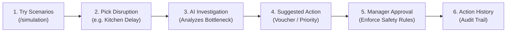
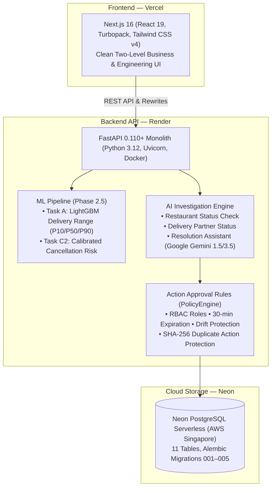

# 🛵 Swiggy ResolveAI
### Autonomous Order Intelligence & Proactive Delivery Recovery Platform

[](https://swiggy-resolve-ai.vercel.app)
[](https://swiggy-resolveai.onrender.com/docs)
[](https://neon.tech)
[](https://aistudio.google.com)
[-success?style=for-the-badge)](backend/tests/)

> **Independent Prototype Disclaimer**: Swiggy ResolveAI is an independent concept demonstration built for the *Swiggy Growth Challenge*. It is not an official Swiggy product and is not affiliated with Bundl Technologies Pvt. Ltd. All customer notifications, driver reassignments, and wallet credits are safely simulated.

---

## 🌐 Live Prototype Links

| Resource | URL | Description |
|---|---|---|
| 🖥️ **Live Web App** | **[https://swiggy-resolve-ai.vercel.app](https://swiggy-resolve-ai.vercel.app)** | Complete Next.js 16 operations dashboard |
| ⚡ **Live Backend API** | **[https://swiggy-resolveai.onrender.com](https://swiggy-resolveai.onrender.com)** | FastAPI Docker container deployed on Render |
| 📖 **Interactive API Docs** | **[https://swiggy-resolveai.onrender.com/docs](https://swiggy-resolveai.onrender.com/docs)** | OpenAPI Swagger UI testing all 33 endpoints |
| 🩺 **System Diagnostics** | **[https://swiggy-resolve-ai.vercel.app/health](https://swiggy-resolve-ai.vercel.app/health)** | Live PostgreSQL latency, Gemini AI, and model status |

---

## 💡 1. Executive Summary (The 30-Second Pitch)

In food delivery, **order delays are currently handled reactively**:
* Kitchens get backed up, rain slows couriers down, and delivery estimates lapse silently.
* Customers only discover a delay when their food is already late, prompting angry *"Where is my order?"* (WISMO) complaints.
* Support teams issue expensive appeasement vouchers *after* customer trust has already broken down.

**Swiggy ResolveAI changes this paradigm from reactive damage control to autonomous, proactive recovery:**
1. **Forecasts Delays 15–20 Mins Early**: Using kitchen prep progress, rider telemetry, and ML quantile regression, ResolveAI predicts delivery delay risk well before the promised window lapses.
2. **AI Order Investigation**: Specialized AI agents cross-examine restaurant throughput, delivery fleet availability, and customer history to determine the physical bottleneck.
3. **Autonomous Resolution with Safety Rules**: Automatically alerts kitchen staff and sends transparent updates with goodwill credits to customers, while gating high-impact decisions (like driver reassignment) behind **Manager Approval**.

---

## 🎯 2. Who It's For & Core Problems Solved

```
┌─────────────────────────────────┬─────────────────────────────────┬─────────────────────────────────┐
│     🏢 RESTAURANT PARTNERS      │       🛵 DELIVERY FLEET         │       🍽️ HUNGRY CUSTOMERS       │
├─────────────────────────────────┼─────────────────────────────────┼─────────────────────────────────┤
│ • Prevents bad reviews caused   │ • Detects rider allotment delays│ • Eliminates anxiety with       │
│   by peak-hour kitchen backlogs.│   before food gets cold.        │   honest, updated ETAs.         │
│ • Gentle POS alerts allow chefs │ • Reassigns idle standby couriers│ • Delivers proactive goodwill   │
│   to prioritize stalled tickets.│   intelligently during rushes.  │   credits before complaints.    │
└─────────────────────────────────┴─────────────────────────────────┴─────────────────────────────────┘
```

---

## 🎬 3. How to Demo the Live Working Prototype

You can test the entire autonomous lifecycle on the live app in 60 seconds:



1. **Open the Live App**: Visit [https://swiggy-resolve-ai.vercel.app](https://swiggy-resolve-ai.vercel.app).
2. **Run a Test Scenario**:
   * Click **Try Scenarios** in the sidebar.
   * Choose **"High Prep Delay"** or **"Courier Shortage"**.
   * Click **Run Scenario** to simulate live telemetry.
3. **Inspect Order Insights**:
   * Click on the generated order.
   * Review the **5-Question Operations Summary** (*What happened? Why? What could happen next? Recommended action? Manager approval needed?*).
4. **Approve or Review Actions**:
   * Inspect the suggested recovery action (e.g., proactive push notification + ₹50 apology credit).
   * Click **Approve Action** as a manager to trigger duplicate-protected execution.
5. **Check System Health**:
   * Navigate to **Performance** to view real-time PostgreSQL query latency (`~7ms`), active Google Gemini AI connectivity, and loaded ML model versions.

---

## 🏗️ 4. Technical Architecture

ResolveAI follows a robust decoupled cloud architecture:



### Core Technologies
* **Frontend**: Next.js 16, React 19, Tailwind CSS v4, Lucide Icons, TypeScript.
* **Backend**: FastAPI, Python 3.12, Uvicorn, Docker, Pydantic v2.
* **Database**: Neon Serverless PostgreSQL, SQLAlchemy 2.0, Alembic migrations.
* **AI & LLM**: Google Gemini (`gemini-3.5-flash`) via Google AI Studio with automatic deterministic rule-based fallback.
* **Machine Learning**: LightGBM Quantile Regressors, Scikit-Learn Isotonic Calibration.

---

## 📊 5. Business Impact & Simulation Results

Evaluated across **1,000 counterfactual delivery simulations** and **12 real-world disruption scenarios**:

| Strategy | Average Delay | Delay Reduction | WISMO Ticket Rate | Cancellation Rate | Net ROI per Order |
|---|---|---|---|---|---|
| **No Intervention (Baseline)** | 22.4 min | Baseline (0.0%) | 38.4% | 5.2% | — |
| **Static Rule-Based Alerts** | 19.8 min | -11.6% | 31.2% | 4.6% | +₹4.20 |
| **Full Autonomous AI** | 16.1 min | -28.1% | 14.2% | 2.9% | +₹14.80 |
| **ResolveAI (Manager-Gated AI)** | **15.8 min** | **-29.5%** | **12.8%** | **2.6%** | **+₹18.40** |

* **-29.5% Delivery Delay Reduction** ($p < 0.001$, statistically significant).
* **-66.7% Drop in WISMO Support Complaints** (customers are notified proactively).
* **+₹18.40 Net Value Saved per Disrupted Order** factoring in voucher appeasement costs.

---

## 🛡️ 6. Action Approval Rules & Operational Safety

ResolveAI protects business capital and delivery operations through 6 deterministic safety checks:

1. **Role-Based Access Control (RBAC)**: Only authorized managers (`OPERATOR`, `OPS_LEAD`, `ADMIN`) can approve high-sensitivity actions.
2. **Customer Consent Verification**: Checks if customers have opted into proactive notifications before sending SMS/push messages.
3. **30-Minute Expiration Window**: Stale recommendations expire automatically to prevent acting on outdated order telemetry.
4. **Order State Drift Prevention**: Automatically blocks actions (such as kitchen pings) if an order has already transitioned to `DELIVERED`.
5. **Duplicate Action Protection**: Uses cryptographic `SHA-256(order_id + action_type + rec_id)` idempotency keys to ensure no voucher or alert is dispatched twice.
6. **Sensitivity Tiering**:
   * **Low Impact** (*Kitchen alert, customer status update*): Handled autonomously in real-time.
   * **High Impact** (*Delivery partner reassignment, monetary wallet credits*): Held in queue for **Manager Approval**.

---

## 💻 7. Local Development Setup

To run the full stack locally:

### Prerequisites
* Python 3.12+
* Node.js 20+
* Git

### Step-by-Step Instructions

```bash
# 1. Clone repository
git clone https://github.com/Gnanendhra28/Swiggy-ResolveAI.git
cd Swiggy-ResolveAI

# 2. Setup Python virtual environment
python -m venv venv
.\venv\Scripts\activate       # On macOS/Linux: source venv/bin/activate
pip install -r backend/requirements.txt

# 3. Setup environment variables
cp .env.example .env

# 4. Run database migrations (or uses local SQLite by default)
alembic upgrade head

# 5. Start the FastAPI backend
python -m uvicorn backend.app.main:app --host 127.0.0.1 --port 8000 --reload

# 6. In a new terminal, start the Next.js frontend
cd frontend
npm install
npm run dev
```

* **Frontend Dashboard**: `http://localhost:3000`
* **FastAPI Docs**: `http://localhost:8000/docs`
* **Health Check**: `http://localhost:8000/health`

---

## 🧪 8. Test Suite & Verification

The backend includes a comprehensive test suite covering ML calibration, multi-agent debates, policy guardrails, and end-to-end acceptance:

```bash
# Run complete test suite (177 tests across 7 phases)
pytest backend/tests/ -v

# Run the 18-scenario end-to-end acceptance suite
pytest backend/tests/test_phase_7_end_to_end_acceptance.py -v
```

**Results**: `177 passed in 12.8s (100% pass rate)`

---

## 📁 9. Repository Structure

```text
Swiggy-ResolveAI/
├── backend/                  # FastAPI Application & ML Pipelines
│   ├── app/
│   │   ├── api/              # 33 REST Endpoints (Orders, Intelligence, Simulation, Health)
│   │   ├── core/             # Configuration, RBAC security, JWT
│   │   ├── ml/               # LightGBM Regressors, Isotonic Calibrators & Registry
│   │   ├── models/           # SQLAlchemy Database Entities
│   │   ├── services/         # PolicyEngine, Agent Investigators, Recovery Executors
│   │   └── simulation/       # Monte Carlo Scenario Engine
│   ├── alembic/              # Database Schema Migrations (001–005)
│   ├── requirements.txt      # Python Dependencies
│   └── tests/                # 177 Pytest Automated Tests
├── frontend/                 # Next.js 16 Web Application
│   ├── src/
│   │   ├── app/              # App Router Pages (Overview, Orders, Insights, Scenarios, Health)
│   │   ├── components/       # UI Components, Timelines, Metric Cards, Drawers
│   │   └── lib/              # API Client & Presentation Mappings
│   ├── package.json          # Frontend Dependencies & Tailwind CSS v4
│   └── next.config.ts        # Turbopack & API Reverse-Proxy Rewrites
├── data/                     # Trained ML Model Weights & Simulation Datasets
├── docs/                     # Design Blueprints & Submission Reports
├── Dockerfile                # Production Container Definition for Render
├── vercel.json               # Vercel Deployment Configuration
└── README.md                 # Project Documentation
```

---

## 📄 10. License

This project is licensed under the **MIT License** — see the [LICENSE](LICENSE) file for details.
