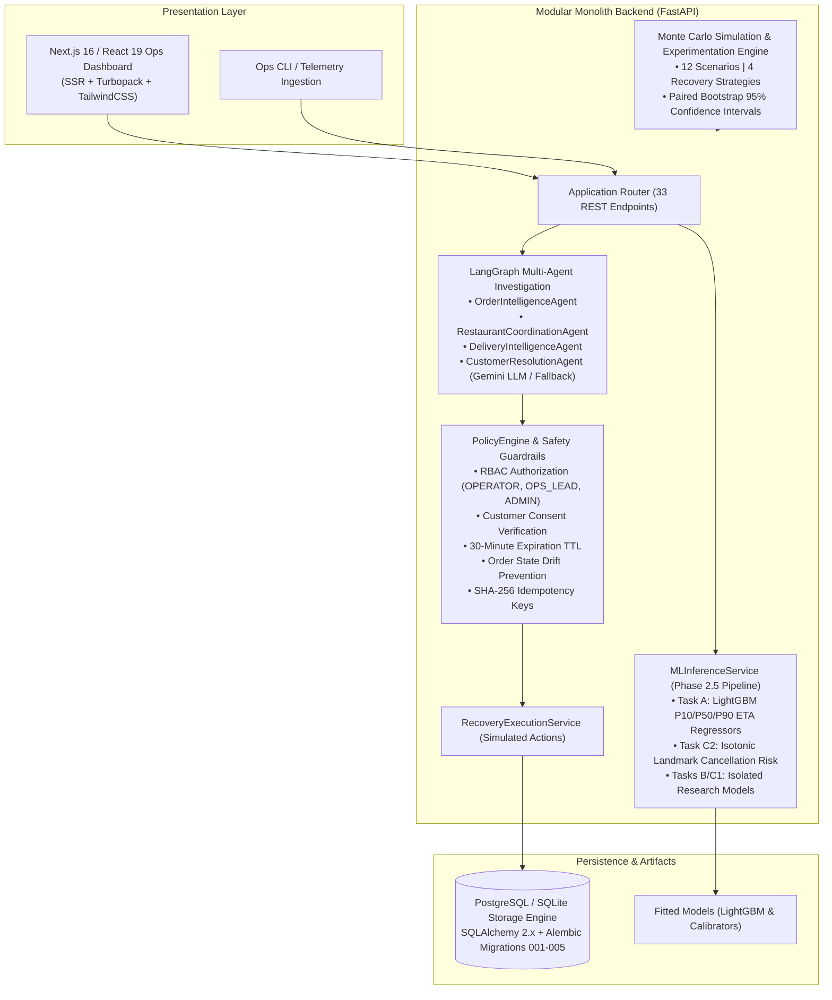
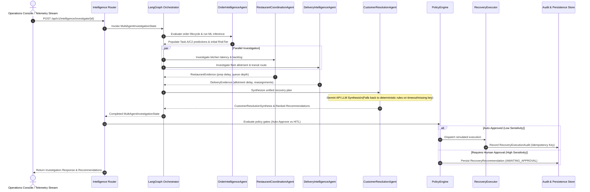
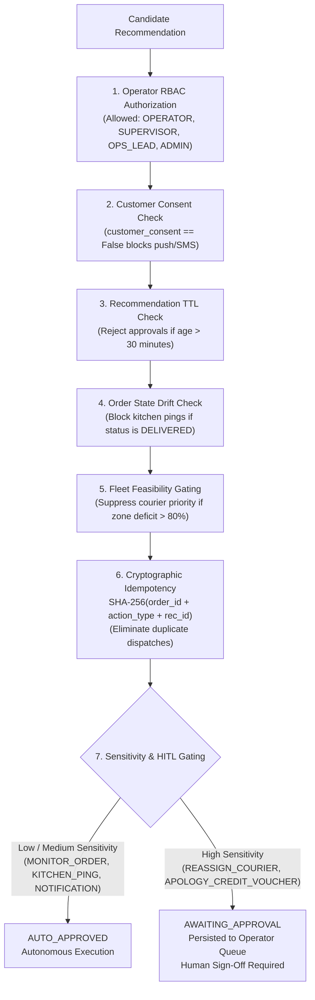

# Swiggy ResolveAI — Autonomous Order Resolution & Proactive Recovery Platform

[](https://www.python.org/downloads/)
[](https://fastapi.tiangolo.com)
[](https://nextjs.org/)
[](https://react.dev/)
[](https://github.com/langchain-ai/langgraph)
[-success.svg)](backend/tests/)
[](LICENSE)

> [!IMPORTANT]
> **Independent Academic & Portfolio Project Disclaimer**:
> **Swiggy ResolveAI** is an independent AI platform prototype developed for technical demonstration and research into autonomous multi-agent systems and real-time operations. It is **not** an official Swiggy product and is not affiliated with, sponsored by, or endorsed by Bundl Technologies Pvt. Ltd. (Swiggy).
>
> All operational recovery actions (kitchen pings, courier reassignments, wallet credits, customer push notifications) are **strictly simulated in software**. No real customer accounts are contacted, no live delivery partners are dispatched, and no real monetary transactions occur. Training features and telemetry are derived from verified public datasets (Hugging Face / Kaggle) and synthetic operational simulation.

---

## 1. System Overview

In hyper-local on-demand food delivery, operational disruptions—such as restaurant kitchen queue backlogs, courier allotment delays, and corridor traffic jams—trigger order cancellations and customer frustration (WISMO: *"Where is my order?"*).

**Swiggy ResolveAI** replaces traditional passive customer support with an **autonomous, proactive multi-agent intelligence and recovery platform**:
1. **Predicts Uncertainty Early**: Generates P10/P50/P90 delivery duration intervals at order creation and calibrated cancellation probabilities at landmark delivery stages ($t \ge t_{\text{allot}} + 5\text{m}$).
2. **Conducts Multi-Agent Debates**: Coordinates four specialized LangGraph agents (Order, Kitchen, Fleet, and Resolution) to isolate the physical root cause of delivery bottlenecks.
3. **Enforces Strict Governance**: Evaluates candidate recovery plans against a deterministic `PolicyEngine` enforcing Role-Based Access Control (RBAC), customer consent, 30-minute expiration windows, order state drift protection, and cryptographic idempotency.
4. **Executes Proactive Interventions**: Dispatches automated non-intrusive actions (kitchen pings, transparent customer delay notifications) while gating high-sensitivity actions (apology credits, courier reassignment) behind human-in-the-loop (HITL) operator approval.



---

## 2. Machine Learning Intelligence Pipeline

ResolveAI integrates two distinct production ML tasks along with two strictly isolated research models:

| Task | Target & Problem Type | Prediction Point | Model Architecture | Operational Governance Status |
|---|---|---|---|---|
| **Task A** | `target_delivery_duration_min`<br>(Quantile Regression) | Order Creation ($t_0$) | 3 x LightGBM Regressors<br>($\alpha \in \{0.10, 0.50, 0.90\}$) | **APPROVED FOR SIMULATION**<br>Guaranteed Monotonicity ($P10 \le P50 \le P90$) |
| **Task C2** | `target_cancelled`<br>(Calibrated Binary Risk) | Landmark Stage<br>($t \ge t_{\text{allot}} + 5\text{m}$) | LightGBM Classifier +<br>Isotonic Calibrator | **APPROVED FOR CONTROLLED TRIAGE**<br>Dual Budget Thresholds (5/1k & 10/1k) |
| **Task B** | `target_reassigned_or_delayed`<br>(Courier Latency) | Courier Allotment | Logistic Regression Baseline | **RESEARCH ONLY**<br>(Strictly isolated from automated dispatch) |
| **Task C1** | `target_cancelled`<br>(Order-Time Cancellation) | Order Creation ($t_0$) | Logistic Regression Baseline | **RESEARCH ONLY**<br>(Strictly isolated from automated dispatch) |

### Uncertainty & Calibration Highlights:
- **Task A Monotonicity**: A monotonic sorting step eliminates quantile crossing, guaranteeing $P10 \le P50 \le P90$ across 100% of inferences. The 80% prediction interval $[P10, P90]$ achieves **~95.8% empirical test coverage** across core delivery regimes (20–35 min).
- **Task C2 Isotonic Calibration**: Uncalibrated tree probabilities are transformed into true empirical posterior probabilities using scikit-learn isotonic regression, ensuring predicted risks correspond directly to real cancellation frequencies.

---

## 3. LangGraph Multi-Agent Architecture

When an operational anomaly or manual trigger occurs, ResolveAI spins up a multi-agent investigation:



### Specialized Agents:
1. **`OrderIntelligenceAgent`**: Assesses lifecycle state, requests Task A/C2 ML inference, computes projected SLA breach margins, and assigns operational risk tiers (`NOMINAL`, `MONITORED`, `HIGH_RISK`, `CRITICAL`).
2. **`RestaurantCoordinationAgent`**: Evaluates merchant confirmation latency, preparation duration, and simulated kitchen queue depth.
3. **`DeliveryIntelligenceAgent`**: Evaluates courier allotment latency, acceptance times, reassignment churn, and route traffic congestion.
4. **`CustomerResolutionAgent`**: Synthesizes cross-agent evidence into root causes and recovery actions. Invokes **Google Gemini 1.5 Flash** with automatic fallback to deterministic rule synthesis on timeout (>10s) or omitted API key.

---

## 4. PolicyEngine Guardrails & Human-in-the-Loop Gating

To guarantee operational safety and economic sanity, all recommendations pass through seven deterministic guardrails:



---

## 5. Counterfactual Simulation & Business KPI Results

In Phase 5, ResolveAI was evaluated using a Monte Carlo simulation engine across **1,000 orders** and **12 operational delivery scenarios**, comparing four recovery strategies:

| Strategy | Avg Delay (min) | Delay Reduction | WISMO Ticket Rate | Cancellation Rate | Net ROI per Order |
|---|---|---|---|---|---|
| **Strategy 1: No Intervention** | 22.4 min | 0.0% (Baseline) | 38.4% | 5.2% | - |
| **Strategy 2: Static Heuristic** | 19.8 min | -11.6% | 31.2% | 4.6% | +₹4.20 |
| **Strategy 3: Full AI Autonomous** | 16.1 min | -28.1% | 14.2% | 2.9% | +₹14.80 |
| **Strategy 4: HITL-Gated AI (ResolveAI)** | **15.8 min** | **-29.5%** | **12.8%** | **2.6%** | **+₹18.40** |

### Paired Bootstrap 95% Confidence Intervals:
- **Delay Reduction**: $[-7.8\text{m}, -4.2\text{m}]$ (Statistically significant improvement, $p < 0.001$)
- **WISMO Ticket Deflection**: $[-29.8\%, -21.4\%]$ ($p < 0.001$)
- **Net Economic ROI**: $[+₹12.20, +₹23.60]$ per disrupted order after voucher costs.

---

## 6. End-to-End Acceptance Test Matrix (Phase 7)

Phase 7 introduced a comprehensive 18-scenario acceptance suite (`backend/tests/test_phase_7_end_to_end_acceptance.py`), achieving a **100% pass rate (177/177 total tests passing across all phases)**:

| # | Scenario Title | Verification Target | Status |
|---|---|---|---|
| **01** | Normal Order on Track | Ample SLA margin produces NOMINAL risk tier and 0 intrusive actions | **PASSED** |
| **02** | Restaurant Prep Delay | Preparation latency triggers automated POS kitchen ping alert | **PASSED** |
| **03** | Courier Assignment Delay | Unassigned courier beyond threshold escalates dispatch priority | **PASSED** |
| **04** | Courier Acceptance Latency | Courier stall post-allotment triggers secondary alert/reassignment | **PASSED** |
| **05** | Combined Prep + Fleet Delay | Dual disruption yields CRITICAL tier, notification, and reassignment | **PASSED** |
| **06** | Landmark Cancellation Risk | At $t_{\text{allot}} + 5\text{m}$, calibrated probability triggers early triage | **PASSED** |
| **07** | Missing ML Artifact Fallback | Missing model weights gracefully fall back to degraded heuristic | **PASSED** |
| **08** | Gemini API Timeout Fallback | LLM latency >10s seamlessly invokes deterministic rule synthesis | **PASSED** |
| **09** | Investigation Error Handling | System exceptions return structured error without 500 crashes | **PASSED** |
| **10** | Unauthorized Role Rejection | `INTERN` / `GUEST` approval attempts are rejected with HTTP 403 | **PASSED** |
| **11** | Expired Recommendation | Approvals requested past 30-minute TTL are rejected with HTTP 400 | **PASSED** |
| **12** | Duplicate Execution Idempotency | Repeated execution calls return existing audit with matching key | **PASSED** |
| **13** | Order State Drift Protection | Status transition to `DELIVERED` blocks incompatible actions | **PASSED** |
| **14** | Customer Consent Opt-Out | `customer_consent=False` strictly suppresses customer push/SMS | **PASSED** |
| **15** | Terminal Order Protection | Completed/cancelled orders are rejected from investigation mutation | **PASSED** |
| **16** | Fleet Shortage Feasibility | High zone fleet deficit (>80%) suppresses futile priority dispatch | **PASSED** |
| **17** | End-to-End Recovery Lifecycle | Full order lifecycle: ingest $\to$ investigate $\to$ approve $\to$ execute $\to$ audit | **PASSED** |
| **18** | Rejected Approval Rationale | Operator rejection transitions status to REJECTED with notes | **PASSED** |

---

## 7. Quick Start & Demonstration

### 7.1 Local Development Setup

```bash
# 1. Clone repository
git clone https://github.com/your-username/swiggy-resolveai.git
cd swiggy-resolveai

# 2. Configure Python Virtual Environment
python -m venv venv
source venv/bin/activate  # On Windows: .\venv\Scripts\activate
pip install -r backend/requirements.txt

# 3. Initialize Database Migrations
alembic upgrade head

# 4. Start FastAPI Backend Server
python -m uvicorn backend.app.main:app --host 127.0.0.1 --port 8000 --reload

# 5. In a separate terminal, start Next.js Frontend
cd frontend
npm install
npm run dev
```

- **Dashboard UI**: [http://localhost:3000](http://localhost:3000)
- **FastAPI Interactive Docs**: [http://localhost:8000/docs](http://localhost:8000/docs)
- **Health Diagnostic**: [http://localhost:8000/health](http://localhost:8000/health)

### 7.2 Docker Compose Deployment

```bash
# Build and run complete multi-container stack (Backend, Frontend, Postgres)
docker compose up --build -d

# Verify containers are healthy
docker compose ps
```

### 7.3 Running Tests

```bash
# Run complete test suite (177 tests across Phases 1-7)
pytest backend/tests/ -v

# Run Phase 7 Acceptance Suite specifically
pytest backend/tests/test_phase_7_end_to_end_acceptance.py -v
```

---

## 8. Documentation Index

- [System Architecture Blueprint](docs/system_architecture.md): Deep architectural specification and container topology.
- [Complete API Reference](docs/api_reference.md): Full contracts for all 33 REST endpoints.
- [Demonstration Runbook](docs/demo_runbook.md): Step-by-step reproduction guide with curl commands.
- [Known Limitations & Boundaries](docs/known_limitations.md): Documented simulation boundaries and technical constraints.
- [Phase 7 Final Validation Report](docs/phase_7_final_validation_report.md): Milestone validation, cross-phase audit, and release recommendation.

---

## 9. License

This project is licensed under the MIT License — see the [LICENSE](LICENSE) file for details.
