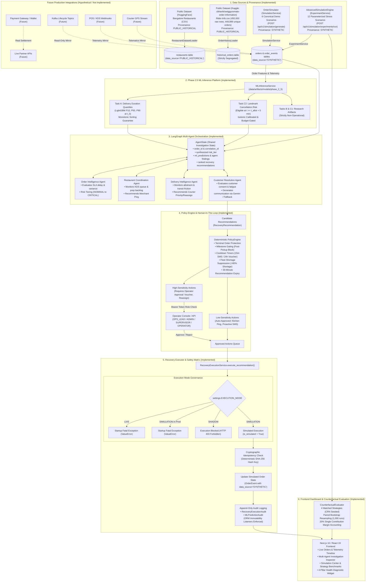

# Swiggy ResolveAI — Architecture & Data Flow Specification

- **Date**: November 19, 2026
- **Auditors**: Principal AI Platform Architect, Senior Backend Engineer
- **Status**: **PORTFOLIO-READY & CODE-VERIFIED**

---

## 1. System Architecture Overview

**Swiggy ResolveAI** is an autonomous operational resilience and order recovery platform designed as a modular monolith following Clean Architecture and SOLID design principles. It monitors order lifecycles, predicts delivery duration intervals and post-landmark cancellation risks, coordinates multi-agent investigation of supply chain disruptions, evaluates policy guardrails, and safely executes simulated recovery actions.

---

## 2. End-to-End Component Breakdown

### 2.1 Data Provenance & Ingestion Isolation
1. **Public Historical Restaurant Data**:
   - Source: Hugging Face Swiggy Bangalore Restaurants dataset.
   - Loader: [`RestaurantDatasetLoader`](file:///c:/Users/ASUS/Desktop/Swiggy%20ResolveAI/backend/app/services/ingestion/restaurant_loader.py).
   - Ingestion: Idempotent upsert into `restaurants` table with `data_source = "PUBLIC_HISTORICAL"`. Null listing attributes (e.g. unlisted coordinates) are preserved as `null` without synthetic fabrication.
2. **Public Historical Lifecycle Telemetry**:
   - Source: Kaggle Swiggy/Zomato Order Information dataset (`cbhavik/swiggyzomato-order-information`, file: `data/raw/orders/Rider-Info.csv`).
   - Row Count Reconciliation: **450,000 raw rows** containing **449,999 unique orders** and exactly **1 duplicate order ID** (`order_id = 181402`). The 45,593 figure found in initial Phase 2.1 documentation referred to an unselected benchmark candidate (`gauravmalik26/food-delivery-dataset`) and does not reflect the local repository dataset.
   - Loader: [`OrderHistoryDatasetLoader`](file:///c:/Users/ASUS/Desktop/Swiggy%20ResolveAI/backend/app/services/ingestion/order_history_loader.py).
   - Ingestion: Strictly segregated into `historical_orders` table. Never mixed with synthetic active orders.
3. **Synthetic Active Delivery Simulation**:
   - **Interactive Demonstration Generator**: [`OrderSimulator`](file:///c:/Users/ASUS/Desktop/Swiggy%20ResolveAI/backend/app/simulation/order_simulator.py) powers `POST /api/v1/simulation/generate` with **6 canonical demo scenarios**:
     1. `NORMAL_ORDER`: Standard seamless lifecycle.
     2. `RESTAURANT_DELAY`: Kitchen backlog causing prep delay exceeding SLA.
     3. `DELIVERY_DELAY`: Route congestion and transit delay.
     4. `ASSIGNMENT_DELAY`: Fleet shortage and allotment timeout.
     5. `FAILED_RECOVERY`: Critical equipment breakdown escalated to human support.
     6. `SUCCESSFUL_RECOVERY`: Autonomous issue detection, fleet re-routing, and proactive appeasement.
   - **Batch Counterfactual Experiment Engine**: [`AdvancedSimulationEngine`](file:///c:/Users/ASUS/Desktop/Swiggy%20ResolveAI/backend/app/simulation/advanced_engine.py) powers `POST /api/v1/simulation/experiments/run` with **12 parameterized operational stress scenarios**:
     `NORMAL_DELIVERY`, `RESTAURANT_PREP_DELAY`, `RESTAURANT_CAPACITY_OVERLOAD`, `COURIER_ASSIGNMENT_DELAY`, `COURIER_ACCEPTANCE_DELAY`, `COURIER_REASSIGNMENT`, `TRAFFIC_CONGESTION`, `LONG_DISTANCE_DELIVERY`, `COMBINED_KITCHEN_DELIVERY_DELAY`, `HIGH_CANCELLATION_RISK`, `FAILED_RECOVERY`, `SUCCESSFUL_RECOVERY`.
   - Ingestion: Generates dynamic synthetic orders and events in `orders` and `order_events` tables with `data_source = "SYNTHETIC"`.

### 2.2 Machine Learning Inference Platform (Phase 2.5)
The platform encapsulates production models within [`MLInferenceService`](file:///c:/Users/ASUS/Desktop/Swiggy%20ResolveAI/backend/app/services/ml_inference.py):
- **Task A (Delivery Duration Quantiles)**:
  - Predicts conditional quantiles $P10, P50, P90$ at order creation ($t_0$) using 16 pre-order and routing covariates.
  - Enforces runtime monotonic quantile sorting: $\hat{y}_{P10} \le \hat{y}_{P50} \le \hat{y}_{P90}$.
  - Flags long-tail uncertainty when interval width $(P90 - P10) > 25.0\text{ min}$.
- **Task C2 (Operational Landmark Cancellation)**:
  - Evaluated strictly at $t \ge t_{\text{allot}} + 5\text{ min}$ (5 minutes post-allotment landmark).
  - Employs LightGBM calibrated via Isotonic Regression.
  - Gated by conservative false-alert budgets: 5 per 1,000 orders and 10 per 1,000 orders.
- **Research Models (Tasks B & C1)**:
  - Persisted as research artifacts; strictly blocked from operational triggers.
- **Fallback Engine**: Missing model artifacts trigger deterministic heuristic fallbacks marked with `confidence="LOW"` and explicit audit provenance.

### 2.3 LangGraph Multi-Agent Orchestration
Implemented in [`backend/app/agents/`](file:///c:/Users/ASUS/Desktop/Swiggy%20ResolveAI/backend/app/agents/):
- **Shared State (`AgentState`)**: Transports immutable order context, real-time telemetry, model inference quantiles, structured agent findings, synthesized risk tiers, and candidate recommendations.
- **Order Intelligence Agent**: Synthesizes elapsed duration against promised SLAs and ML quantiles, classifying operational risk (`NOMINAL`, `MONITORED`, `HIGH_RISK`, `CRITICAL`).
- **Restaurant Coordination Agent**: Evaluates simulated Kitchen Display System (KDS) prep backlogs. Recommends merchant pings when prep delay exceeds thresholds.
- **Delivery Intelligence Agent**: Monitors courier allotment latency, acceptance delays, and first-mile transit friction. Recommends courier priority dispatch or reassignment.
- **Customer Resolution Agent**: Synthesizes cross-agent findings to identify root cause. Evaluates customer consent and notification cooldowns. Generates customer communication using Google Gemini with an automated deterministic fallback engine.

### 2.4 Deterministic Policy Engine & HITL Gating
Implemented in [`PolicyEngine`](file:///c:/Users/ASUS/Desktop/Swiggy%20ResolveAI/backend/app/services/policy_engine.py):
- **Terminal Order State Protection**: Actions on `DELIVERED` or `CANCELLED` orders are blocked.
- **Milestone Progression Gating**: Kitchen expedite pings are rejected once food is picked up.
- **Cooldown Timers**: Customer notifications enforce a 15-minute cooldown; apology vouchers enforce a 24-hour customer cooldown.
- **Fleet Shortage Feasibility**: Courier priority dispatches are suppressed if zone fleet shortage exceeds 80%.
- **Recommendation Time-To-Live**: Unapproved recommendations expire automatically after 30 minutes.
- **Human-in-the-Loop (HITL) Gate**: High-sensitivity actions (`APOLOGY_CREDIT_VOUCHER`, `REASSIGN_COURIER`) require explicit approval from an authenticated operator with an authorized role (`OPERATOR`, `OPS_LEAD`, `ADMIN`, `SUPERVISOR`). Unauthorized roles (`INTERN`) are rejected with `HTTP 403 Forbidden`.

### 2.5 Recovery Execution & Append-Only Audit Logging
Implemented in [`RecoveryExecutionService`](file:///c:/Users/ASUS/Desktop/Swiggy%20ResolveAI/backend/app/services/recovery_executor.py):
- **Execution Mode Safety Matrix**:
  - `SIMULATION`: Allowed only in non-production environments (`development`, `testing`, `staging`). Modifies simulated database states with `is_simulated = True`.
  - `SHADOW`: Permitted in all environments. Allows inference, debate, and scoring; strictly blocks recovery execution (`HTTP 403 Forbidden`).
  - `LIVE`: Safety governance block. Fails safely at application startup with `ValueError`.
- **Idempotency Guarantee**: Every executed action verifies a deterministic SHA-256 idempotency key (`order_id:action_type:disambiguator`), preventing duplicate side-effects. Duplicate replays return `status = "ALREADY_EXECUTED"`.
- **Audit Immutability**: `RecoveryExecutionAudit` and `MLPredictionAudit` implement SQLAlchemy ORM event listeners (`before_update`, `before_delete`) that raise `PermissionError` on any modification attempt.

### 2.6 Frontend Dashboard & Counterfactual Evaluation
- **Frontend Architecture**: Next.js 16 App Router with React 19, TailwindCSS, and Lucide React.
  - Live orders monitoring and visual telemetry timeline.
  - Multi-agent debate inspector displaying agent thoughts, evidence, and risk tiers.
  - Simulation Center supporting interactive scenario injection.
  - 4-pillar health diagnostic widget (Database, ML Artifacts, Agent System, Execution Safety).
- **Counterfactual Evaluation Engine**:
  - Evaluates 4 canonical strategies against identical matched initial order states:
    1. `Strategy 1 — Baseline Monitoring`
    2. `Strategy 2 — Rule-Based Recovery`
    3. `Strategy 3 — ML-Assisted Recovery`
    4. `Strategy 4 — Full ResolveAI Multi-Agent Recovery`
  - Utilizes Common Random Numbers (CRN) seeded per order.
  - Computes 1,000 paired bootstrap resamples preserving order pairing.
  - Applies **single 20% contribution margin accounting** on gross avoided losses, disclaiming results as simulated model estimates.
