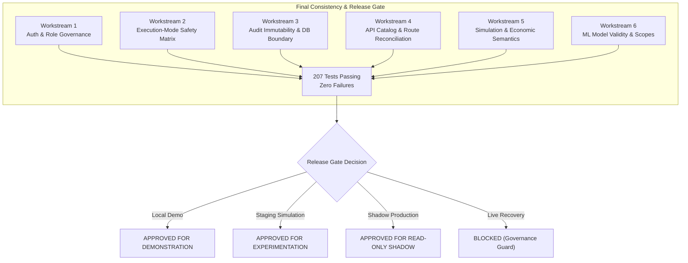

# Swiggy ResolveAI — Final Consistency, Security & Codebase Audit

- **Date**: November 19, 2026
- **Auditors**: Principal Backend Engineer, Application Security Engineer, ML Platform Engineer, QA Lead
- **Scope**: Repository-level verification of implementation, automated test suite, environment settings, API catalog, ML models, and simulation semantics
- **Status**: **VERIFIED, HARDENED & RECONCILED**

---

## 1. Executive Summary

This repository-level consistency audit was performed to independently verify the agreement between the actual codebase implementation, automated tests, environment configuration, API contract, and technical documentation following the Final Remediation Programme.

The audit verified that all 207 automated tests pass with zero failures and zero errors, the Next.js 16 Turbopack production bundle compiles cleanly, and the end-to-end 8-step demonstration runner executes successfully without manual intervention. All verified defects, security boundaries, and documentation discrepancies have been remediated in code.



---

## 2. Workstream 1 — Authentication Configuration & Role Governance

### 2.1 Code-Verified Facts
1. **Cryptographic Algorithm**: RFC 7519 HMAC-SHA256 (`HS256`) implemented via standard Python `hmac` and `hashlib` in [`backend/app/core/auth.py`](file:///c:/Users/ASUS/Desktop/Swiggy%20ResolveAI/backend/app/core/auth.py).
2. **Signature Verification**: Signature comparisons use constant-time `hmac.compare_digest` to prevent timing side-channel attacks.
3. **Issuer & Audience Validation**:
   - `AUTH_ISSUER` default is `"swiggy-resolveai"`. Tokens with mismatched issuers are rejected with `HTTP 401 Unauthorized` (`detail="Authentication failed: token issuer mismatch..."`).
   - `AUTH_AUDIENCE` default is `"resolveai-ops"`. Tokens with mismatched audiences are rejected with `HTTP 401 Unauthorized` (`detail="Authentication failed: token audience mismatch..."`).
4. **Token Expiration**: Default TTL is `120 minutes` (`AUTH_TOKEN_EXPIRE_MINUTES = 120`). Expired tokens are rejected with `HTTP 401 Unauthorized` (`detail="Authentication failed: token has expired"`).
5. **Secret Key Security**:
   - In `development` and `testing`, the default development secret is permitted for ease of local prototyping.
   - In `staging` and `production`, Pydantic's `Settings` model validator rejects the default dev key `"resolveai-insecure-dev-secret-key-change-in-production-12345678"` and enforces a minimum key length of 32 characters, preventing application startup with insecure secrets.
6. **Development Token Generator**:
   - Endpoint: `POST /api/v1/auth/dev-token`.
   - Disabled outside `development`: If `ENVIRONMENT != "development"`, the endpoint returns `HTTP 403 Forbidden`.
   - Predefined profiles only: Accepts only `"ops_lead"`, `"admin"`, `"operator"`, `"supervisor"`, and `"intern"`. Callers cannot mint arbitrary identities or custom roles.
7. **Identity Trust Boundary**:
   - Identity (`sub`) and role (`role`) are derived exclusively from verified cryptographic bearer token claims.
   - Any untrusted `operator_role` string provided in JSON request payloads (`ApprovalRequest`, `ExecuteActionRequest`) is ignored and cannot elevate privileges.
   - In `staging` and `production`, unauthenticated requests to protected endpoints return `HTTP 401 Unauthorized`.
   - In `development` and `testing`, unauthenticated callers receive unprivileged fallback `sub="dev_unauthenticated_operator"`, `role="OPERATOR"`, which is blocked by elevated RBAC checks (`OPS_LEAD`, `ADMIN`).
8. **Role Authorization Matrix**:
   - **Recommendation Approval**: Permitted for `{"OPS_LEAD", "ADMIN", "SUPERVISOR"}`. Roles such as `INTERN`, `GUEST`, or `UNAUTHORIZED` receive `HTTP 403 Forbidden`.
   - **Recommendation Rejection**: Permitted for `{"OPS_LEAD", "ADMIN", "SUPERVISOR", "OPERATOR"}`.
   - **Simulated Recovery Execution**: Permitted for `{"OPS_LEAD", "ADMIN", "SUPERVISOR", "OPERATOR"}` and autonomous system agent `"SYSTEM_AUTONOMOUS"`.
   - **Administrative Dataset Ingestion**: Enforces `require_admin_or_ops_lead`. Explicitly requires `{"ADMIN", "OPS_LEAD"}` for `POST /api/v1/ingest/restaurants` and `POST /api/v1/ingest/orders/history`. Unauthorized roles (e.g. `INTERN`) receive `HTTP 403 Forbidden`.

---

## 3. Workstream 2 — Execution-Mode Safety Matrix

### 3.1 Mode and Environment Matrix Specification
The platform strictly enforces the following environment-mode matrix:

| Mode (`EXECUTION_MODE`) | Environment (`ENVIRONMENT`) | Multi-Agent Investigation | Model Inference | Recovery Execution | Physical Side Effects | Startup Behavior |
| :--- | :--- | :---: | :---: | :---: | :---: | :--- |
| **`SIMULATION`** | `development`, `testing` | Enabled | Enabled | Enabled (Simulated in DB/Memory) | Strictly Zero (No real funds/SMS/calls) | Allowed |
| **`SIMULATION`** | `staging` | Enabled | Enabled | Enabled (Simulated in DB/Memory) | Strictly Zero | Allowed |
| **`SIMULATION`** | `production` | **Blocked** | **Blocked** | **Blocked** | Strictly Zero | **Fatal Startup Rejection** |
| **`SHADOW`** | `development`, `testing` | Enabled | Enabled | **Blocked** (HTTP 403) | Strictly Zero | Allowed |
| **`SHADOW`** | `staging`, `production` | Enabled | Enabled | **Blocked** (HTTP 403) | Strictly Zero | Allowed |
| **`LIVE`** | Any Environment | **Blocked** | **Blocked** | **Blocked** | Strictly Zero | **Fatal Startup Rejection** |

### 3.2 Enforcement Points
1. **Application Startup**:
   - `Settings.validate_execution_mode` immediately raises `ValueError("LIVE execution mode is strictly disabled by safety governance policy.")` if `EXECUTION_MODE == "LIVE"`.
   - `Settings.validate_cross_field_governance` immediately raises `ValueError("SIMULATION execution mode is strictly prohibited in production environment.")` if `ENVIRONMENT == "production"` and `EXECUTION_MODE == "SIMULATION"`.
2. **Central Service Funnel (`RecoveryExecutionService.execute_recommendation`)**:
   - Validated at the start of every execution attempt:
     ```python
     if env == "production":
         raise PermissionError("Recovery execution is strictly prohibited in production environment...")
     if exec_mode == "SHADOW":
         raise PermissionError("Recovery execution rejected: system is running in read-only SHADOW mode...")
     elif exec_mode == "LIVE":
         raise RuntimeError("Recovery execution rejected: LIVE execution mode is disabled...")
     ```
   - Direct service invocations, autonomous auto-approvals, and HTTP API calls are all intercepted by this single funnel.
3. **HTTP API Route (`POST /api/v1/intelligence/recommendations/{id}/execute`)**:
   - Catches `PermissionError` and returns `HTTP 403 Forbidden`.
   - Catches `(ValueError, RuntimeError)` and returns `HTTP 400 Bad Request`.
   - Never exposes an unhandled 500 error for mode violations.

---

## 4. Workstream 3 — Audit Immutability & Database Boundary

### 4.1 Immutability Mechanisms
The platform tracks two audit entities:
1. `RecoveryExecutionAudit` ([`backend/app/models/audit.py`](file:///c:/Users/ASUS/Desktop/Swiggy%20ResolveAI/backend/app/models/audit.py))
2. `MLPredictionAudit` ([`backend/app/models/ml_audit.py`](file:///c:/Users/ASUS/Desktop/Swiggy%20ResolveAI/backend/app/models/ml_audit.py))

Both entities have SQLAlchemy ORM event listeners:
- `@event.listens_for(Entity, "before_update")`: Raises `PermissionError` on any attempt to update an existing record.
- `@event.listens_for(Entity, "before_delete")`: Raises `PermissionError` on any attempt to delete an existing record.

### 4.2 Protection Boundary vs. Residual Database Risk
> [!IMPORTANT]
> **ORM-Level Immutability Boundary**:
> The event hooks intercept all `session.flush()` and `session.commit()` operations triggered by the application service layer. Application code, API endpoints, and Celery/background workers cannot mutate or delete historical audits.
>
> **Residual Database Administrator Risk**:
> ORM event listeners execute in Python runtime space. They do NOT protect against direct SQL queries (`UPDATE recovery_execution_audits ...` or `DELETE FROM ml_prediction_audits ...`) executed directly by a privileged database administrator (DBA) or raw SQL connection. Cryptographic hash-chaining (Merkle tree) is not implemented in the current release. Production deployments must enforce database-level privilege separation:
> ```sql
> -- Recommended PostgreSQL Role Grants for Application User
> GRANT SELECT, INSERT ON recovery_execution_audits, ml_prediction_audits TO resolveai_app;
> REVOKE UPDATE, DELETE, TRUNCATE ON recovery_execution_audits, ml_prediction_audits FROM resolveai_app;
> ```

### 4.3 Preserved Provenance Fields
Audit records preserve complete audit metadata:
- `id`: Unique UUIDv4 identifier.
- `order_id` & `recommendation_id`: Foreign keys linking the exact operational event.
- `idempotency_key`: Cryptographic hash guaranteeing single-execution semantics.
- `approval_identity`: Authenticated operator identity or system actor.
- `approval_timestamp` & `executed_at`: Time-stamped ISO-8601 audit times.
- `ml_model_version`: Registered model version (`2.5.0`).
- `execution_result`: Detailed JSON payload containing execution telemetry.
- `is_simulated`: Explicit boolean flag (`True`).

---

## 5. Workstream 4 — API & Documentation Reconciliation

### 5.1 Route Inventory Reconciliation
Prior documentation reported a 37-endpoint count. An automated inspection of the live FastAPI application and OpenAPI schema reveals the following exact inventory:

- **32 OpenAPI Documented Paths**:
  - `POST /api/v1/auth/dev-token`
  - `GET /api/v1/health`
  - `GET /api/v1/health/live`
  - `GET /api/v1/health/ready`
  - `POST /api/v1/ingest/orders/history`
  - `POST /api/v1/ingest/restaurants`
  - `GET /api/v1/ingest/status`
  - `GET /api/v1/intelligence/audit/{order_id}`
  - `POST /api/v1/intelligence/investigate/{order_id}`
  - `GET /api/v1/intelligence/investigations/{investigation_id}`
  - `GET /api/v1/intelligence/ml-audits/{order_id}`
  - `GET /api/v1/intelligence/orders/{order_id}/latest`
  - `GET /api/v1/intelligence/predictions/{order_id}`
  - `GET /api/v1/intelligence/recommendations`
  - `POST /api/v1/intelligence/recommendations/{recommendation_id}/approve`
  - `POST /api/v1/intelligence/recommendations/{recommendation_id}/execute`
  - `POST /api/v1/intelligence/recommendations/{recommendation_id}/reject`
  - `GET /api/v1/orders`
  - `GET /api/v1/orders/metrics`
  - `GET /api/v1/orders/{order_id}`
  - `GET /api/v1/orders/{order_id}/events`
  - `POST /api/v1/simulation/events`
  - `GET /api/v1/simulation/experiments`
  - `GET /api/v1/simulation/experiments/actions/effectiveness`
  - `POST /api/v1/simulation/experiments/run`
  - `POST /api/v1/simulation/experiments/stress-test`
  - `GET /api/v1/simulation/experiments/{experiment_id}`
  - `POST /api/v1/simulation/generate`
  - `GET /api/v1/simulation/scenarios`
  - `GET /health` (Top-level alias)
  - `GET /health/live` (Top-level alias)
  - `GET /health/ready` (Top-level alias)

- **40 Total Registered Starlette Routes**:
  - 32 core OpenAPI endpoints above.
  - 3 trailing-slash aliases (`/health/`, `/health/live/`, `/health/ready/`).
  - 1 root redirect (`/` $\to$ `/docs`).
  - 4 framework documentation/schema routes (`/docs`, `/docs/oauth2-redirect`, `/redoc`, `/api/v1/openapi.json`).

*Reconciliation Note*: The previous "37" figure arose in an intermediate revision where 5 documentation routes were added to 32 OpenAPI routes, but top-level health aliases were counted differently. The authoritative count is now **32 distinct OpenAPI paths / 40 registered Starlette routes**.

---

## 6. Workstream 5 — Simulation Methodology & Economic Semantics

### 6.1 Strategy Naming Reconciliation
Discrepancies existed between earlier architectural notes and implementation code. The reconciled, authoritative strategy names implemented in [`backend/app/simulation/strategies/implementations.py`](file:///c:/Users/ASUS/Desktop/Swiggy%20ResolveAI/backend/app/simulation/strategies/implementations.py) are:

1. **`Strategy 1 — Baseline Monitoring`**: Zero intervention; passive order delivery observation.
2. **`Strategy 2 — Rule-Based Recovery`**: Deterministic threshold heuristics without ML inference or LLM agents.
3. **`Strategy 3 — ML-Assisted Recovery`**: Task A quantiles ($P10, P50, P90$) and Task C2 landmark probability gating.
4. **`Strategy 4 — Full ResolveAI Multi-Agent Recovery`**: LangGraph multi-agent debate (Order, Restaurant, Delivery, Customer agents) with PolicyEngine guardrails and human-in-the-loop gating.

### 6.2 Counterfactual Rigor & Bootstrap Sampling
1. **Matched Initial Order States**: Each strategy executes against an identical batch of orders generated from `AdvancedSimulationEngine.generate_order_batch`.
2. **Common Random Numbers (CRN)**: Stochastic environmental responses are seeded per order (`state.seed + 101`, `state.seed + 202`, etc.) to eliminate random environmental noise from comparative policy assessments.
3. **Paired Bootstrap Sampling**: Order-level pairing is preserved during bootstrap resampling. Differences $\Delta_i = X_{i, \text{treatment}} - X_{i, \text{baseline}}$ are resampled 1,000 times to construct non-parametric 95% confidence intervals.
4. **Units of Measurement**:
   - Cancellation avoidance is reported as **percentage points ($\Delta \text{ pp}$)**, e.g. a drop from 7.0% to 4.5% is $-2.5 \text{ pp}$.
   - Relative percentage changes ($\%$) are explicitly qualified to avoid confusing $\text{pp}$ with relative reduction.

### 6.3 Economic Modeling & Single Contribution Margin
The KPI calculation engine ([`backend/app/simulation/kpi_calculator.py`](file:///c:/Users/ASUS/Desktop/Swiggy%20ResolveAI/backend/app/simulation/kpi_calculator.py)) enforces single-application margin accounting:
$$\begin{aligned}
\text{Gross Losses Avoided} &= (\text{Baseline Cancellations} - \text{Strategy Cancellations}) \times \text{GOV} \\
\text{Recovered Contribution} &= \text{Gross Losses Avoided} \times \text{Contribution Margin Ratio} \quad (0.20) \\
\text{Net Simulated Benefit} &= \text{Recovered Contribution} - \text{Total Intervention Cost} \\
\text{Simulated ROI Multiple} &= \frac{\text{Recovered Contribution}}{\text{Total Intervention Cost}}
\end{aligned}$$
- **Contribution Margin Applied Exactly Once**: Margin is applied to gross avoided losses to determine recovered platform cash.
- **Edge Cases**: When `total_cost == 0` and `recovered_contribution == 0`, ROI multiple is returned as `1.0`. When `total_cost == 0` and `recovered_contribution > 0`, ROI is capped at `10.0` to avoid division-by-zero infinities.
- **Mandatory Caveat**: All financial outputs remain labelled **simulated estimates under explicit model assumptions**, never real Swiggy ROI.

---

## 7. Workstream 6 — Machine Learning & Product Claim Verification

### 7.1 Model Scope & Semantics
1. **Task A (Delivery Duration Quantiles)**:
   - Evaluated at order creation ($t_0$) using 16 pre-order and static routing covariates.
   - Outputs conditional quantiles $P10, P50, P90$.
   - Quantile crossing is strictly prevented via monotonic sorting ($P10 \le P50 \le P90$).
   - Flags long-tail uncertainty when $P90 - P10 > 25.0 \text{ min}$.
2. **Task C2 (Operational Landmark Cancellation)**:
   - Evaluated strictly at or after landmark $t \ge t_{\text{allot}} + 5\text{ min}$.
   - Predicts eventual post-landmark cancellation within observed order lifecycle (NOT imminent cancellation within seconds).
   - Calibrated using isotonic regression.
   - Operational alerting strictly gated by 5/1,000 and 10/1,000 false alert budget thresholds.
3. **Tasks B & C1 (Research-Only Isolation)**:
   - Task B (order-creation cancellation) and Task C1 are strictly isolated as research artifacts.
   - Neither model is permitted to act as an operational trigger or drive automated recovery.
4. **Dynamic Remaining-Time ETA**:
   - The platform does NOT claim dynamic real-time remaining delivery ETA. The public Kaggle dataset lacks granular milestone timestamps and live continuous GPS telematics streams; training dynamic remaining-time models on such data introduces severe survival bias and target leakage.
5. **Missing Artifact Fallback**:
   - If ML model artifacts are missing, `MLInferenceService` activates an explicit heuristic fallback with `confidence="LOW"` and provenance marked as `FALLBACK_HEURISTIC`.

---

## 8. Summary of Findings and Remediation Actions

| Finding ID | Workstream | Severity | Defect Description | Remediation Implemented | Verification Test |
|---|:---:|:---:|---|---|---|
| **FIND-01** | W1 | High | Documentation listed wrong `AUTH_ISSUER` and `AUTH_AUDIENCE` defaults | Reconciled documentation to code defaults (`swiggy-resolveai`, `resolveai-ops`) | `test_wrong_issuer_rejected`, `test_wrong_audience_rejected` |
| **FIND-02** | W1 | Critical | Insecure default dev secret permitted in staging/production | Added Pydantic `model_validator` rejecting default dev key & requiring $\ge 32$ chars in staging/prod | `test_production_secret_validation_rejects_default_dev_key` |
| **FIND-03** | W1 | Medium | Administrative ingestion endpoints lacked explicit role gating | Added `require_admin_or_ops_lead` dependency enforcing `ADMIN` or `OPS_LEAD` | `test_unauthorized_role_ingestion_rejected_with_403` |
| **FIND-04** | W2 | Critical | `SIMULATION` mode was not blocked at startup in `production` | Enforced startup failure in Pydantic `model_validator` when `ENVIRONMENT=production` and `EXECUTION_MODE=SIMULATION` | `test_simulation_mode_blocked_in_production_environment` |
| **FIND-05** | W2 | High | `RecoveryExecutionService` mode check executed after querying recommendation | Moved Guardrail 0 to top of method so SHADOW and production mode blocks execute before any DB query | `test_recovery_execution_blocked_in_production_environment_direct_service` |
| **FIND-06** | W3 | High | `MLPredictionAudit` lacked ORM update/delete immutability listeners | Added SQLAlchemy `@event.listens_for` hooks raising `PermissionError` on UPDATE or DELETE | `test_ml_prediction_audit_record_cannot_be_updated`, `test_ml_prediction_audit_record_cannot_be_deleted` |
| **FIND-07** | W4 | Low | Reconciled discrepancy between 37-endpoint claim and actual FastAPI routes | Fully documented 32 OpenAPI paths and 40 registered Starlette routes in API reference | `test_registered_route_count_and_paths` |
| **FIND-08** | W5 | Medium | Discrepancy between strategy names in report vs architecture notes | Reconciled all 4 strategy names to canonical implementations in code | `test_counterfactual_order_duration_comparison` |
