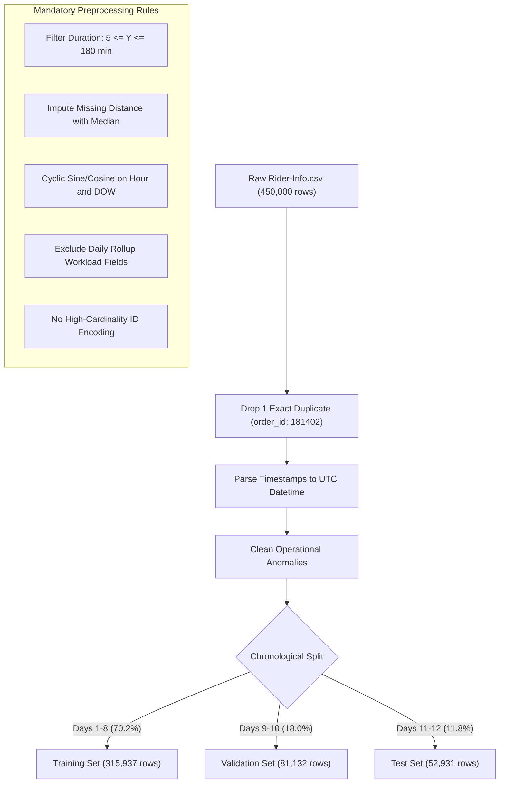

# Swiggy ResolveAI — Phase 2.1 Machine Learning Problem Definition

**Document ID:** `docs/phase_2_1_ml_problem_definition.md`  
**Phase:** 2.1 — Dataset Audit & ML Problem Definition  
**Role:** Senior Machine Learning Engineer  
**Date:** November 18, 2026  
**Status:** Strategy Defined & Mathematically Formalized  

---

## 1. Executive Overview & Problem Context

ResolveAI is designed as an autonomous operational intelligence engine for on-demand food delivery. To support proactive bottleneck detection and autonomous recovery, ResolveAI requires high-precision, leak-free machine learning models capable of predicting operational failures **before** or **as** they occur in the delivery lifecycle.

This document establishes the machine learning problem definitions, mathematical targets, point-in-time feature availability constraints, data leakage safeguards, and chronological evaluation strategy for Phase 2.

```
                    ORDER LIFECYCLE & PREDICTION TIMESTAMPS
    
  [t_order] ───────────────► [t_allot] ───────────────► [t_pickup] ───────────────► [t_delivered]
      │                          │                          │                           │
      ▼                          ▼                          ▼                           ▼
Prediction Point 1         Prediction Point 2         Prediction Point 3         Terminal State
  • Task A (Pre-dispatch)    • Task A (Post-allot ETA)  • Task A (Transit ETA)     • Order Fulfilled
  • Task B (Alloc Delay)     • Task C (Dynamic Cancel)  • Issue Detection
  • Task C (Pre-dispatch)
```

---

## 2. Formal Definition of Machine Learning Tasks

### 2.1 Task A: Delivery Duration Regression (Dynamic ETA Prediction)

#### Operational Objective:
Predict the total elapsed duration from order creation to customer doorstep delivery to set initial customer expectations, detect delayed orders proactively, and schedule timely recovery actions.

#### Mathematical Target Definition:
$$Y_A = \frac{\text{delivered\_time} - \text{order\_time}}{60.0} \quad (\text{in minutes})$$

#### Cohort Eligibility Criteria:
1. Orders must be completed deliveries: `cancelled == 0` ($N = 444,782$).
2. Both `order_time` and `delivered_time` must be valid timestamps.
3. Outlier and corrupt record filtering: $5.0 \le Y_A \le 180.0$ minutes.
   - Filters 89 records where duration $< 5$ minutes (unrealistic fulfillment).
   - Filters 400 records where duration $> 180$ minutes (unclosed system tasks, max = 10,017 mins).
   - **Eligible Training Population:** **444,293 orders** (98.73% of raw dataset).

#### Prediction Timestamps & Multi-Stage Architecture:
In production food-delivery architectures (e.g. Swiggy, DoorDash), ETA prediction is **multi-stage**:
1. **Stage 1 — Pre-Dispatch ETA (at $t_{\text{order}}$):**
   - **Prediction Timestamp:** Order creation time ($t_{\text{order}}$).
   - **Operational Purpose:** Initial SLA display and driver dispatch timing.
   - **Allowed Features:** `last_mile_distance`, temporal cyclic features (`order_hour`, `order_dayofweek`, `is_weekend`), historical demand density.
   - **Forbidden / Leaked Features:** `allot_time`, `accept_time`, `pickup_time`, `delivered_time`, `first_mile_distance`, `rider_id`, `session_time`, `reassigned_order`.
2. **Stage 2 — Post-Dispatch ETA (at $t_{\text{allot}}$):**
   - **Prediction Timestamp:** Rider allotment time ($t_{\text{allot}}$).
   - **Allowed Features:** Stage 1 features + `first_mile_distance`, courier shift `session_time`, courier career order volume tier (`lifetime_order_count`).
3. **Stage 3 — Transit ETA (at $t_{\text{pickup}}$):**
   - **Target:** $Y_{A3} = \frac{\text{delivered\_time} - \text{pickup\_time}}{60.0}$ (Transit Duration).
   - **Allowed Features:** `last_mile_distance`, actual food prep duration (`pickup_time - order_time`), courier transit conditions.

#### Target Distribution Profile (Cleaned Cohort, $N = 444,293$):
- **Minimum:** 5.02 minutes
- **25th Percentile:** 23.40 minutes
- **Median:** 29.33 minutes
- **Mean:** 32.28 minutes
- **75th Percentile:** 38.65 minutes
- **99th Percentile:** 75.80 minutes
- **Maximum:** 179.88 minutes
- **Distribution Shape:** Log-normal / right-skewed with peak around 26–32 minutes.

#### Evaluation Metrics:
- **Primary:** Mean Absolute Error (MAE in minutes), Root Mean Squared Error (RMSE).
- **Operational SLA Metrics:**
  - $\text{Accuracy}_{\pm 5\text{ min}}$: Percentage of predictions within $\pm 5$ minutes of ground truth.
  - $\text{Under-prediction Rate}$: Frequency where actual $> \text{predicted} + 10\text{ min}$ (late surprise penalty).
  - Quantile Pinball Loss ($q_{0.1}, q_{0.5}, q_{0.9}$) for probabilistic delivery windows.

---

### 2.2 Task B: Rider Allocation Delay Risk (Classification & Conditional Duration)

#### Operational Objective:
Identify orders at high risk of prolonged allocation latency or courier rejection immediately upon order placement, enabling ResolveAI to widen the dispatch search radius or trigger operational alerts.

#### Mathematical Formulation:
In normal operations, courier assignment is near-instantaneous (median $0.25$ minutes / 15 seconds). A delay exceeding 3 minutes indicates fleet shortage, rider rejection, or repushing to the allocation pool.

We formulate Task B as a **two-tier problem**:
1. **Primary Model (Binary Classification):** Predict probability of abnormal allocation delay:
   $$Y_{B,\text{class}} = \mathbb{I}\left(\frac{\text{allot\_time} - \text{order\_time}}{60.0} > 3.0\right)$$
   - Class 0 (Normal Dispatch $\le 3$ min): 422,480 orders (**93.88%**)
   - Class 1 (Delayed Dispatch $> 3$ min): 27,520 orders (**6.12%**)
   - Optional high-severity threshold ($> 5$ min): 19,540 orders (**4.34%**)
2. **Secondary Model (Conditional Delay Regression):** For orders predicted as delayed, predict the expected delay in minutes:
   $$Y_{B,\text{reg}} = \frac{\text{allot\_time} - \text{order\_time}}{60.0} \quad \text{for } Y_{B,\text{class}} = 1$$

#### Cohort Eligibility Criteria:
- All placed orders with valid `order_time` and `allot_time` ($N = 450,000$).
- Cleaned of non-causal negative values ($N_{\text{neg}} = 0$).

#### Prediction Timestamp:
- Strictly at order placement time ($t_{\text{order}}$).

#### Feature Availability & Critical Leakage Restrictions:
- **Allowed Features at $t_{\text{order}}$:**
  - `last_mile_distance`
  - `order_hour`, `order_dayofweek`, `is_weekend`, `is_peak_meal_window`
  - Rolling backward-looking demand pressure: order volume in preceding 15m, 30m, 60m across the system.
- **Strictly Prohibited Leaks:**
  - **`reassigned_order` / `reassignment_method` / `reassignment_reason`:** 100% future information.
  - **`first_mile_distance`:** Computed from the assigned courier's GPS location; unknown before allocation.
  - **`rider_id`, `session_time`:** Telemetry of the assigned courier; unknown prior to assignment.
  - **`allot_time` itself:** In reassigned orders, `allot_time` is the second rider's timestamp; utilizing any downstream rider feature creates circular target leakage.

#### Evaluation Metrics:
- Precision-Recall AUC (PR-AUC) — essential due to 6.12% positive class imbalance.
- Precision@K (e.g. Precision at top 5% highest-risk orders).
- ROC-AUC and Macro F1-score.

---

### 2.3 Task C: Cancellation Risk Classification

#### Operational Objective:
Predict the likelihood of order abort/cancellation to trigger autonomous agent intervention (e.g. proactive customer communication, merchant check, fleet compensation) before the customer cancels in frustration.

#### Mathematical Target Definition:
$$Y_C = \text{cancelled} \in \{0, 1\}$$
- Class 0 (Delivered): 444,782 (**98.84%**)
- Class 1 (Cancelled): 5,218 (**1.16%**)
- Target Imbalance Ratio: **1 : 85.2**

#### Prediction Horizons & Staged Evaluation:
Cancellation is a multi-phase operational breakdown. We define two distinct prediction horizons:
1. **Horizon 1 — Upfront Demand Risk (at $t_{\text{order}}$):**
   - Assesses macro risk factors: extreme last-mile distance, severe fleet congestion, late-night ordering.
2. **Horizon 2 — In-Flight Operational Risk (Dynamic at $t_{\text{allot}} + 5\text{ min}$):**
   - Evaluates operational friction: rider has not accepted within 2 minutes, order is reassigned, or preparation duration exceeds expected threshold.
   - **Eligible Cohort:** Orders active 5 minutes post-allotment.

#### Permitted Features vs Severe Target Leaks:
- **Strictly Prohibited Features (Direct Target Leaks):**
  - `cancelled_time`: Non-null **only** for cancelled orders (444,782 nulls). Using this column yields a trivial, 100% leaky classifier.
  - `delivered_time`: Null for all cancellations. Using nullness of `delivered_time` is identical to target leakage.
  - `pickup_time`: Missing for 46.4% of cancellations (2,421 out of 5,218). Models at $t_{\text{order}}$ or $t_{\text{allot}}$ must not require `pickup_time`.
- **Permitted Features at Horizon 1 ($t_{\text{order}}$):**
  - `last_mile_distance`, `order_hour`, `order_dayofweek`, rolling recent cancellation rate in the zone over previous 60 minutes.
- **Permitted Features at Horizon 2 ($t_{\text{allot}} + 5\text{ min}$):**
  - Elapsed allotment delay (`allot_time - order_time`), `first_mile_distance`, courier `session_time`, whether courier acceptance is lagging (`accept_time - allot_time > 2 min`).

#### Evaluation Metrics:
- **PR-AUC (Average Precision):** Primary metric for severe class imbalance.
- **Recall at 90% Precision:** Ensures that when ResolveAI autonomous recovery fires, 9 out of 10 flagged orders are genuinely at risk, minimizing costly unnecessary customer vouchers.
- **Brier Score:** Evaluates calibration of predicted probabilities.

---

## 3. Point-in-Time Feature Availability Matrix

The following matrix governs the lifecycle availability of every dataset feature. Any feature marked with ❌ at a given prediction milestone is **legally forbidden** from model input at that timestamp.

| Feature Name | Source Field | Type | At Order Placement ($t_{\text{order}}$) | At Rider Allotment ($t_{\text{allot}}$) | At Kitchen Food Ready ($t_{\text{ready}}$) | At Rider Pickup ($t_{\text{pickup}}$) | Post Delivery ($t_{\text{delivered}}$) |
|---|---|---|:---:|:---:|:---:|:---:|:---:|
| `last_mile_distance` | `last_mile_distance` | Float | ✅ Available | ✅ Available | ✅ Available | ✅ Available | ✅ Available |
| `order_hour` | Derived (`order_time`) | Int | ✅ Available | ✅ Available | ✅ Available | ✅ Available | ✅ Available |
| `order_dayofweek` | Derived (`order_time`) | Int | ✅ Available | ✅ Available | ✅ Available | ✅ Available | ✅ Available |
| `is_weekend` | Derived (`order_time`) | Bool | ✅ Available | ✅ Available | ✅ Available | ✅ Available | ✅ Available |
| `rolling_order_volume_30m` | Engineered | Float | ✅ Available | ✅ Available | ✅ Available | ✅ Available | ✅ Available |
| `allot_time` | `allot_time` | Datetime | ❌ **Leak** | ✅ Available | ✅ Available | ✅ Available | ✅ Available |
| `allot_delay_min` | Derived | Float | ❌ **Leak** | ✅ Available | ✅ Available | ✅ Available | ✅ Available |
| `rider_id` | `rider_id` | Categorical | ❌ **Leak** | ✅ Available | ✅ Available | ✅ Available | ✅ Available |
| `first_mile_distance` | `first_mile_distance` | Float | ❌ **Leak** | ✅ Available | ✅ Available | ✅ Available | ✅ Available |
| `session_time` | `session_time` | Float | ❌ **Leak** | ✅ Available | ✅ Available | ✅ Available | ✅ Available |
| `lifetime_order_count` | `lifetime_order_count` | Float | ❌ **Leak** | ⚠️ Static Snapshot | ⚠️ Static Snapshot | ⚠️ Static Snapshot | ⚠️ Static Snapshot |
| `accept_time` | `accept_time` | Datetime | ❌ **Leak** | ❌ **Leak** | ✅ Available | ✅ Available | ✅ Available |
| `accept_delay_min` | Derived | Float | ❌ **Leak** | ❌ **Leak** | ✅ Available | ✅ Available | ✅ Available |
| `reassigned_order` | `reassigned_order` | Bool | ❌ **Leak** | ⚠️ Overwritten | ✅ Available | ✅ Available | ✅ Available |
| `reassignment_reason` | `reassignment_reason` | Categorical | ❌ **Leak** | ⚠️ Overwritten | ✅ Available | ✅ Available | ✅ Available |
| `pickup_time` | `pickup_time` | Datetime | ❌ **Leak** | ❌ **Leak** | ❌ **Leak** | ✅ Available | ✅ Available |
| `prep_duration_min` | Derived | Float | ❌ **Leak** | ❌ **Leak** | ❌ **Leak** | ✅ Available | ✅ Available |
| `alloted_orders` | `alloted_orders` | Float | ❌ **Daily Rollup Leak** | ❌ **Daily Rollup Leak** | ❌ **Daily Rollup Leak** | ❌ **Daily Rollup Leak** | ❌ **Daily Rollup Leak** |
| `delivered_orders` | `delivered_orders` | Float | ❌ **Daily Rollup Leak** | ❌ **Daily Rollup Leak** | ❌ **Daily Rollup Leak** | ❌ **Daily Rollup Leak** | ❌ **Daily Rollup Leak** |
| `undelivered_orders` | `undelivered_orders` | Float | ❌ **Daily Rollup Leak** | ❌ **Daily Rollup Leak** | ❌ **Daily Rollup Leak** | ❌ **Daily Rollup Leak** | ❌ **Daily Rollup Leak** |
| `cancelled_time` | `cancelled_time` | Datetime | ❌ **Target Leak** | ❌ **Target Leak** | ❌ **Target Leak** | ❌ **Target Leak** | ❌ **Target Leak** |
| `delivered_time` | `delivered_time` | Datetime | ❌ **Target Leak** | ❌ **Target Leak** | ❌ **Target Leak** | ❌ **Target Leak** | ❌ **Target Leak** |

---

## 4. Feature Engineering Proposal

### 4.1 Spatial Features
- `last_mile_distance`: Primary linear predictor of transit duration.
- `last_mile_distance_sq`: Quadratic term capturing non-linear transit delays in dense urban traffic.
- `distance_bracket`: Binned categorical feature:
  - Ultra-short: $[0.0, 1.0)$ km
  - Short: $[1.0, 2.5)$ km
  - Medium: $[2.5, 5.0)$ km
  - Long: $[5.0, 8.0)$ km
  - Hyper-long: $\ge 8.0$ km
- `first_to_last_mile_ratio` (available at $t_{\text{allot}}$): $\frac{\text{first\_mile\_distance}}{\text{last\_mile\_distance} + 0.1}$. High ratios indicate courier is poorly positioned relative to delivery trajectory.

### 4.2 Temporal & Cyclic Features
- `order_hour`: Hour of day ($0 \dots 23$).
- Cyclic sine/cosine encoding to preserve 24-hour circular continuity:
  $$\text{hour\_sin} = \sin\left(\frac{2\pi \cdot \text{hour}}{24}\right), \quad \text{hour\_cos} = \cos\left(\frac{2\pi \cdot \text{hour}}{24}\right)$$
- `order_dayofweek`: Day of week ($0 = \text{Monday} \dots 6 = \text{Sunday}$).
  $$\text{dow\_sin} = \sin\left(\frac{2\pi \cdot \text{dow}}{7}\right), \quad \text{dow\_cos} = \cos\left(\frac{2\pi \cdot \text{dow}}{7}\right)$$
- `is_weekend`: Binary flag for Saturday/Sunday demand patterns.
- `meal_period`: Operational time windows:
  - `BREAKFAST`: 07:00 – 10:59
  - `LUNCH_PEAK`: 11:00 – 14:59
  - `AFTERNOON_SLACK`: 15:00 – 18:29
  - `DINNER_PEAK`: 18:30 – 22:59
  - `LATE_NIGHT`: 23:00 – 06:59

### 4.3 Rolling Demand Pressure (Leak-Free Historical Windows)
To capture fleet congestion without leaking future records, compute rolling backward-looking aggregations based strictly on $t < t_{\text{order}}$:
- `orders_past_15min`: Total orders placed in the entire system during $[t_{\text{order}} - 15\text{m}, t_{\text{order}})$.
- `orders_past_60min`: Total orders placed in $[t_{\text{order}} - 60\text{m}, t_{\text{order}})$.
- `demand_acceleration`: $\frac{\text{orders\_past\_15min} \times 4}{\text{orders\_past\_60min} + 1.0}$. Measures sudden demand surges.

### 4.4 Courier State Features (Available at $t_{\text{allot}}$)
- `session_time`: Continuous minutes courier has been logged into current shift.
- `session_time_hours`: $\frac{\text{session\_time}}{60.0}$.
- `fatigue_index`: Binary indicator for prolonged shift duration ($\text{session\_time} > 480\text{ mins}$ / 8 hours).
- `first_mile_distance`: Physical distance courier must travel to reach restaurant.

### 4.5 Categorical Identifier Constraints
> [!IMPORTANT]
> **Strict Prohibition on Raw Identifiers as Numerical Features:**
> - `order_id` and `rider_id` must **never** be fed as raw numerical features into tree or linear models.
> - `order_id` is a monotonically incrementing key; treating it as a numeric feature causes models to memorize chronological order rather than physical dynamics.
> - `rider_id` has 19,537 high-cardinality values with a long tail (median 14 orders). High-cardinality target encoding without strict out-of-fold regularization creates catastrophic overfitting. If used, couriers must be grouped into coarse frequency buckets (e.g. Courier Experience Tier: $< 10$, $10–50$, $> 50$ orders).

---

## 5. Comprehensive Leakage & Validity Audit Report

Our rigorous audit identified seven distinct leakage and validity hazards that must be enforced during model development:

### 1. Static Snapshot Backfill Leakage (`lifetime_order_count`)
- **Empirical Finding:** `lifetime_order_count` has exactly 1 unique value across all 12 days for each rider ($N_{\text{variance}} = 0$).
- **Hazard:** Reflects the courier's lifetime deliveries at the date the database was dumped (February 2021), not their experience at the moment of order placement in January 2021.
- **Remedy:** Do not use as a continuous precision counter. If retained, bin into broad historical deciles.

### 2. Daily Batch Partition Rollup Leakage (`alloted_orders`, `delivered_orders`, `undelivered_orders`)
- **Empirical Finding:** The within-day standard deviation across orders for any individual courier on any single date is **0.000**.
- **Hazard:** These fields capture the courier's end-of-day cumulative performance. Using `delivered_orders` for an order placed at 09:00 AM leaks the courier's deliveries from 21:00 PM that evening.
- **Remedy:** **Strictly ban** all three fields from real-time prediction pipelines ($t_{\text{order}}$, $t_{\text{allot}}$).

### 3. Reassignment Timestamp Overwrite
- **Empirical Finding:** In the 13,753 reassigned orders, `allot_time` is shifted by an average of 19.27 minutes because it logs the second rider's allotment.
- **Hazard:** Models trained on `allot_time` assuming it represents initial dispatch will learn false correlations between initial distance and final allotment.
- **Remedy:** Acknowledge `allot_time` as final dispatch timestamp; formulate Task B explicitly to predict the risk of entering this delayed reassignment pool.

### 4. Post-Hoc Flag Leakage (`reassigned_order`, `reassignment_method`, `reassignment_reason`)
- **Empirical Finding:** Populated on 3.06% of rows; 96.94% are null.
- **Hazard:** These flags are written **after** a reassignment occurs. Using them at order placement ($t_{\text{order}}$) leaks future operational failures.
- **Remedy:** Completely exclude from $t_{\text{order}}$ models. Only permissible in post-reassignment diagnostic models.

### 5. Downstream Milestone Outcome Leakage (`cancelled_time`, `delivered_time`)
- **Hazard:** `cancelled_time` is non-null only for cancellations. `delivered_time` is null for all cancellations.
- **Remedy:** Exclude both fields from all feature matrices. They define target labels exclusively.

### 6. Missing Intermediate Milestone Artifacts
- **Empirical Finding:** 46.4% of cancellations have missing `pickup_time`.
- **Hazard:** Filtering rows requiring non-null `pickup_time` inadvertently deletes nearly half the positive cancellation instances, biasing the training sample.
- **Remedy:** Stage models chronologically; early-stage models must not require downstream milestone features.

### 7. Mixed Population Provenance
- **Dataset Context:** The Kaggle dataset is titled `swiggyzomato-order-information` and contains consolidated telemetry across Indian food delivery aggregator platforms during January–February 2021.
- **License & Research Boundary:** Public research dataset released for academic evaluation. ResolveAI maintains explicit data provenance tags (`PUBLIC_HISTORICAL`) and does not claim direct private API connectivity.

---

## 6. Data Preprocessing & Cleaning Pipeline



### 6.1 Preprocessing Transformations:
1. **Deduplication:** Remove the single duplicate instance of `order_id: 181402` (`keep='first'`), reducing dataset to 449,999 rows.
2. **Timestamp Parsing:** Standardize all timestamp strings to UTC `datetime64[ns]`.
3. **Target Filtering for Task A:** Restrict delivery duration regression cohort to completed orders with $5.0 \le Y_A \le 180.0$ minutes.
4. **Distance Imputation:** For the 94 records where `last_mile_distance == 0.0`, impute with the global median ($2.67\text{ km}$) and add a binary indicator column `is_zero_distance`.
5. **Categorical Imputation:** Impute `reassigned_order` NaN values as `0.0`, and `reassignment_method` / `reassignment_reason` NaN values as `'NONE'`.

---

## 7. Training, Validation & Evaluation Splitting Strategy

### 7.1 Prohibition of Random K-Fold Cross-Validation
> [!CAUTION]
> **Random splitting (e.g. `train_test_split(shuffle=True)`) is strictly forbidden.**
> Food delivery operations are inherently time-dependent: traffic congestion, seasonal weather, day-of-week demand spikes, and fleet availability evolve continuously over time. Shuffling historical orders introduces severe future-to-past data leakage and produces artificially optimistic evaluation metrics that collapse in production.

### 7.2 Chronological Out-of-Time Splitting Strategy
The dataset spans 12 continuous calendar days from Tuesday, January 26, 2021 to Saturday, February 06, 2021. We establish a strict chronological cut:

| Split Partition | Calendar Date Range | Order Count | Percentage | Operational Role |
|---|---|---|---|---|
| **Training Set** | `2021-01-26` to `2021-02-02` (8 full days) | **315,937** | **70.21%** | Model parameter training & gradient boosting fitting. |
| **Validation Set** | `2021-02-03` to `2021-02-04` (2 full days) | **81,132** | **18.03%** | Hyperparameter tuning, early stopping, threshold optimization. |
| **Test Set (Holdout)** | `2021-02-05` to `2021-02-06` (1.5 days) | **52,931** | **11.76%** | Final unbiased out-of-time benchmark evaluation. |
| **Total** | `2021-01-26` to `2021-02-06` | **450,000** | **100.00%** | Full audited population. |

#### Structural Advantages:
- The training split captures a complete 7-day weekly cycle (Tuesday through the following Tuesday), exposing models to both weekday and weekend demand profiles.
- Validation and Test sets evaluate predictions strictly on future, unseen operating dates.

---

## 8. Recommended Model Types & Baselines

### 8.1 Task A: Delivery Duration Regression (ETA)
- **Primary Model:** **LightGBM Regressor / XGBoost Regressor**
  - Fast histogram-based gradient boosting capable of handling non-linear distance-time relationships.
  - Multi-quantile loss: Fit three separate models with pinball loss at $\alpha = 0.10, 0.50, 0.90$ to provide asymmetric prediction intervals (e.g. ETA: 28 mins, 80% CI: $[22, 36]\text{ mins}$).
- **Alternative / Deep Model:** **TabNet or Multi-Layer Perceptron (MLP)** with entity embeddings for temporal features.
- **Baseline Heuristic:** Median delivery duration per distance bracket ($2.5\text{ km}$ bins) cross-tabulated with meal periods.

### 8.2 Task B: Allocation Delay Risk
- **Primary Model:** **CatBoost Classifier / LightGBM Classifier**
  - Native categorical handling and robust leaf-wise splits on rolling demand pressure features.
  - Class imbalance handling: Set `scale_pos_weight = 15.3` (ratio of negative to positive cases).
- **Baseline Heuristic:** Frequency-based alert rule: Flag any order placed during peak hours (19:00–21:00) with last-mile distance $> 5\text{ km}$.

### 8.3 Task C: Cancellation Risk Classification
- **Primary Model:** **Balanced Random Forest / LightGBM with Focal Loss**
  - Mitigates the 1:85.2 class imbalance by downsampling majority non-cancelled orders across bootstrap ensembles or utilizing Focal Loss ($\gamma = 2.0, \alpha = 0.25$) to concentrate gradients on hard-to-classify edge cases.
  - **Probability Calibration:** Apply isotonic regression or Platt scaling on the validation partition to ensure output probabilities represent reliable empirical risk percentages.
- **Decision Threshold Policy:** Optimize the decision threshold for operational action at a target precision of 80%–90%, ensuring ResolveAI autonomous recovery agents are not dispatched on false alarms.
- **Baseline Heuristic:** Constant empirical prior ($1.16\%$) or unweighted logistic regression.

---

## 9. Conclusion & Phase 2.1 Sign-Off

Phase 2.1 has established an empirical data foundation and leak-free formulation:
1. All 450,000 raw order rows and 8,680 restaurant listings have been audited down to exact distributions and anomalies.
2. Subtle temporal leakage in courier history fields (`lifetime_order_count`, `alloted_orders`) has been diagnosed and quarantined.
3. Three distinct operational ML tasks (ETA Regression, Allocation Delay Classification, Cancellation Risk) have been mathematically specified with strict point-in-time feature boundaries.
4. A 70/18/12 chronological out-of-time splitting strategy has been designed to prevent temporal lookahead bias.

**Next Steps (Phase 2.2):**
Upon review and approval of this specification, proceed to feature engineering implementation, baseline training pipelines, and offline evaluation in Phase 2.2.
