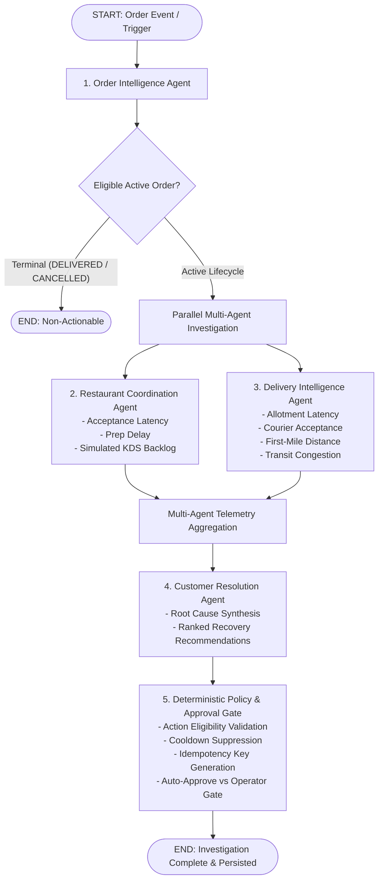
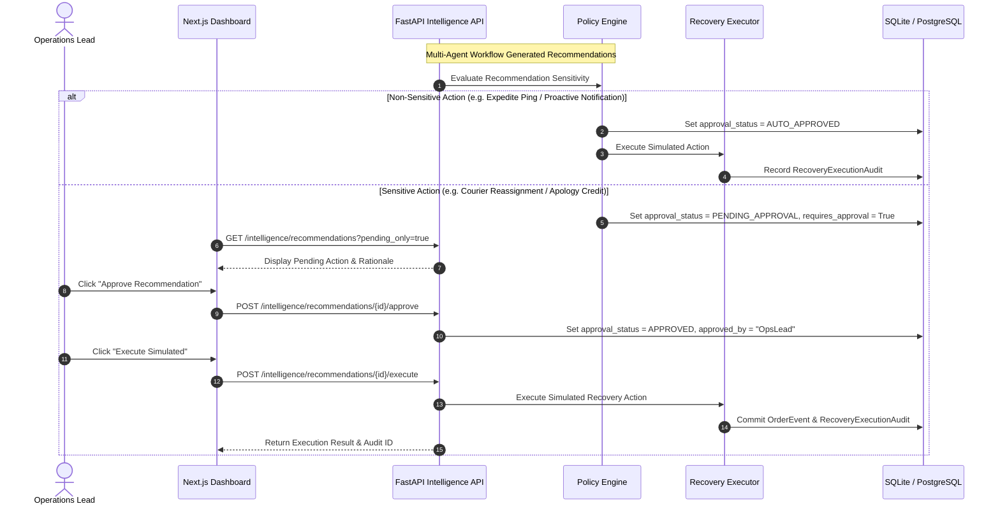

# Swiggy ResolveAI — Phase 3: Multi-Agent Intelligence & Autonomous Recovery System

**Document Version:** 1.0.0  
**Phase:** 3 — Multi-Agent Intelligence, LangGraph Orchestration & Autonomous Recovery  
**Status:** Completed & Fully Verified  
**Date:** 2026-11-18  
**Backend Framework:** FastAPI / LangGraph / SQLAlchemy / Pydantic  
**Frontend Framework:** Next.js 16 (App Router / Turbopack / TailwindCSS)  
**Target ML Model Registry:** Version 2.5.0 (`data/artifacts/models/phase_2_5/`)  

---

## 1. Executive Summary

Phase 3 transitions Swiggy ResolveAI from offline machine learning benchmarking into an autonomous, closed-loop operational intelligence system. Built upon the validated Phase 2.5 predictive models and Phase 1 simulation foundation, Phase 3 implements an agentic architecture orchestrated by **LangGraph**, governed by a **Deterministic Policy Engine**, and presented through an interactive **Next.js operations dashboard**.

### Key Architectural Milestones Achieved:
1. **Dedicated ML Inference Service (`MLInferenceService`):**
   - Decoupled from LLM agents.
   - Loads and validates approved Phase 2.5 artifacts: Task A ETA conditional quantiles ($P_{10}, P_{50}, P_{90}$) and Task C2 Landmark cancellation LightGBM classifier with Isotonic Calibrator.
   - Enforces monotonic quantile ordering ($P_{10} \le P_{50} \le P_{90}$) and strict landmark eligibility ($t \ge t_{\text{allot}} + 5\text{m}$).
   - Isolates Task B (Allocation Delay) and Task C1 (Upfront Cancellation) as research-only models with strict flags prohibiting standalone operational triggers.
2. **Four Specialized Autonomous Agents Coordinated via LangGraph:**
   - **Order Intelligence Agent:** Evaluates order lifecycle eligibility, calls ML inference, and computes deterministic operational risk tiering (`NOMINAL`, `MONITORED`, `HIGH_RISK`, `CRITICAL`).
   - **Restaurant Coordination Agent:** Investigates merchant acceptance latency, food preparation pace, and simulated kitchen queue depth (strictly labeled `SIMULATED_TELEMETRY`).
   - **Delivery Intelligence Agent:** Audits courier allotment latency, courier acceptance delay, first-mile distance, route congestion index, and reassignment history without claiming access to external live systems.
   - **Customer Resolution Agent:** Synthesizes multi-agent root causes and proposes ranked, evidence-grounded, non-intrusive recovery actions.
3. **Deterministic Policy and Approval Engine (`PolicyEngine`):**
   - Strictly bars LLMs from executing sensitive business mutations.
   - Gates high-sensitivity recovery actions (`REASSIGN_COURIER`, `APOLOGY_CREDIT_VOUCHER`) behind explicit Human-in-the-Loop operator approvals.
   - Enforces idempotency keys and cooldown windows (e.g. 15-minute suppression window for proactive notifications; 1 voucher limit per order).
4. **Simulated Recovery Execution & Transactional Audit Trail (`RecoveryExecutionService`):**
   - Executes approved recovery actions strictly within the simulated environment (no real payments, SMS, or external API calls).
   - Generates immutable transactional audit records (`recovery_execution_audits`) tracking initial state, trigger reason, ML model version, operator identity, outcome, and payload.
5. **Full API & Dashboard Integration:**
   - Versioned FastAPI endpoints under `/api/v1/intelligence`.
   - Real-time Next.js dashboard visualizer with quantile intervals, calibrated probability gauges, multi-agent reasoning panels, and interactive approve/reject/execute operator controls.
6. **Rigorous Verification:**
   - Full backend test suite passing with **88/88 tests passing (100%)** in 15.38 seconds.
   - Clean Next.js production build (`npm run build`) passing without errors.

---

## 2. Agent Architecture & LangGraph Orchestration

The agentic core is coordinated via a compiled LangGraph `StateGraph(MultiAgentInvestigationState)`. State flows through deterministic routing, agent investigations, customer synthesis, and deterministic policy gating.

### LangGraph Workflow Diagram



### Typed Shared LangGraph State Schema

```python
class MultiAgentInvestigationState(TypedDict, total=False):
    order_id: str
    external_order_id: str
    order_context: Dict[str, Any]
    order_events: List[Dict[str, Any]]
    ml_predictions: Optional[Dict[str, Any]]
    risk_tier: RiskTier
    restaurant_investigation: Optional[Dict[str, Any]]
    delivery_investigation: Optional[Dict[str, Any]]
    evidence_and_provenance: Dict[str, Any]
    resolution_synthesis: Optional[Dict[str, Any]]
    recovery_recommendations: List[Dict[str, Any]]
    policy_validation: Dict[str, Any]
    human_approval_status: Dict[str, Any]
    execution_results: List[Dict[str, Any]]
    workflow_status: InvestigationStatus
    errors: List[str]
```

---

## 3. Machine Learning Inference Service Integration

The dedicated ML service (`backend/app/services/ml_inference.py`) operates independently of LLM reasoning, executing feature preprocessing, model inference, and statistical calibration with zero data leakage.

### 1. Task A — Pre-dispatch Delivery Duration Regression (ETA)
- **Artifacts:** `task_a_quantile_p10.joblib`, `task_a_quantile_p50.joblib`, `task_a_quantile_p90.joblib`.
- **Inputs:** 16 order-time numerical and categorical features (`last_mile_distance`, `meal_period`, `distance_bracket`, cyclical temporal encodings, rolling order acceleration).
- **Quantile Ordering Guarantee:** Enforces $P_{10} \le P_{50} \le P_{90}$. If numerical predictions cross due to independent quantile loss functions, sorted sorting is automatically applied and logged (`crossing_corrected=True`).
- **Uncertainty Interval:** Returns the 80% coverage interval $[P_{10}, P_{90}]$ and interval width $P_{90} - P_{10}$.
- **Long-Tail Safeguard:** When $P_{50} > 40.0\text{m}$ or $P_{90} > 50.0\text{m}$, estimates are tagged `is_long_tail=True, confidence='LOW'`. Explicit disclaimer: *"P90 is an uncertainty interval upper bound, never a guaranteed delivery time."*

### 2. Task C2 — Operational Landmark Cancellation Risk
- **Artifacts:** `task_c2_improved_model.joblib` (LightGBM) and `task_c2_calibrator.joblib` (Isotonic Regressor).
- **Landmark Eligibility Rule:** Evaluated strictly when $t \ge t_{\text{allot}} + 5\text{m}$ and order status is non-terminal. If evaluated prior to 5 minutes post-allotment, inference gracefully exits with `is_eligible=False` and clear explanation.
- **Inputs:** 26 features (16 order-time features + 10 post-landmark operational features: `first_mile_distance`, `is_extreme_first_mile`, `first_to_last_mile_ratio`, `allot_delay_min`, `has_accepted_by_landmark`, `accept_delay_at_landmark`, etc.).
- **Isotonic Calibration:** Raw LightGBM predicted probability is calibrated to match empirical prevalence.
- **Alert Budgets:**
  - **Budget 5/1,000 Orders:** Threshold = `0.6686` (Validation Precision: 17.7%, Test Precision: 25.0%).
  - **Budget 10/1,000 Orders:** Threshold = `0.5113` (Validation Precision: 12.5%, Test Precision: 16.4%).
- **Target Semantics:** Eventual post-landmark cancellation within observed lifecycle (not imminent cancellation). Approved strictly for non-intrusive monitoring.

### 3. Research-Only Task Isolation (Task B & Task C1)
- Task B (Allocation Delay) and Task C1 (Upfront Cancellation) are loaded exclusively for comparative research.
- Explicitly assigned `is_operational_trigger=False` and governance statuses `NOT_APPROVED` (Task B) and `RESEARCH_ONLY` (Task C1). They are strictly blocked from triggering operational interventions.

---

## 4. Specialized Agent Implementations & Telemetry

### Agent 1: Order Intelligence Agent
- **File:** `backend/app/agents/order_intelligence.py`
- **Responsibilities:** Evaluates order lifecycle state; queries `MLInferenceService`; compares projected ETA against customer promised delivery time; evaluates cancellation alert budget triggers; determines operational risk tier:
  - `CRITICAL`: Task C2 budget 5/1k alert triggered, OR $\ge 2$ courier reassignments, OR ETA delay $> 20$ minutes.
  - `HIGH_RISK`: Task C2 budget 10/1k alert triggered, OR ETA delay $> 10$ minutes, OR P90 delay $> 15$ minutes.
  - `MONITORED`: ETA delay $> 0$ minutes, OR P90 delay $> 5$ minutes, OR long-tail order, OR 1 reassignment.
  - `NOMINAL`: Operations on schedule within SLA buffer.

### Agent 2: Restaurant Coordination Agent
- **File:** `backend/app/agents/restaurant_coordination.py`
- **Responsibilities:** Inspects merchant acceptance latency ($t_{\text{accept}} - t_{\text{placed}}$); checks kitchen prep pace vs nominal 16-minute window; reads simulated KDS queue depth.
- **Telemetry Distinction:** Simulated queue depth is labeled `SIMULATED_TELEMETRY` (no historical order contains actual kitchen queue telemetry).
- **Output:** Structured `RestaurantEvidence` with suspected cause, delay magnitude, and operational confidence.

### Agent 3: Delivery Intelligence Agent
- **File:** `backend/app/agents/delivery_intelligence.py`
- **Responsibilities:** Evaluates courier allotment latency ($t_{\text{allot}} - t_{\text{created}}$); assesses first-mile transit distance ($> 3.0\text{ km}$ triggers extreme first-mile flag); tracks courier acceptance latency; inspects simulated traffic congestion index.
- **Guardrail:** Does not claim access to real Swiggy fleet GPS or municipal traffic sensors.
- **Output:** Structured `DeliveryEvidence` with fleet impact, courier ID, and reassignment count.

### Agent 4: Customer Resolution Agent
- **File:** `backend/app/agents/customer_resolution.py`
- **Responsibilities:** Synthesizes multi-agent root causes; identifies primary bottleneck (`RESTAURANT_KITCHEN`, `COURIER_DISPATCH`, `TRANSIT_TRAFFIC`, or `NOMINAL`); evaluates customer impact severity; generates ranked recovery recommendations.
- **LLM & Fallback Integration:** Supports structured output via Gemini when configured, with a deterministic, rule-grounded synthesis engine providing 100% reliable fallback in test and local environments.

---

## 5. Deterministic Policy and Approval Engine

The Policy Engine (`backend/app/services/policy_engine.py`) guarantees that autonomous models operate within safe operational bounds.

### Policy Rules Matrix

| Action Type | Sensitivity Level | Approval Requirement | Eligibility & Cooldown Preconditions |
| :--- | :--- | :--- | :--- |
| `MONITOR_ORDER` | `LOW` | **Auto-Approved** | Non-terminal orders. Low-frequency background telemetry. |
| `EXPEDITE_KITCHEN_PING` | `LOW` | **Auto-Approved** | Valid only while order status is `PREPARING`. Blocked if food is already marked ready or picked up. |
| `PRIORITIZE_COURIER_DISPATCH` | `LOW` | **Auto-Approved** | Valid when courier allotment latency $> 2.5\text{m}$ or courier not yet accepted. |
| `PROACTIVE_CUSTOMER_NOTIFICATION` | `MEDIUM` | **Auto-Approved** | Provides transparent ETA update. **15-minute cooldown window** suppresses duplicate customer notifications. |
| `REASSIGN_COURIER` | `HIGH` | **HUMAN APPROVAL REQUIRED** | Blocked if courier has already picked up order (`OUT_FOR_DELIVERY`). 10-minute cooldown window between reassignments. |
| `APOLOGY_CREDIT_VOUCHER` | `HIGH` | **HUMAN APPROVAL REQUIRED** | Limited to **max 1 voucher per order**. Gated strictly for verified critical delay or high cancellation risk. |

### Human-in-the-Loop Approval Workflow



---

## 6. Simulated Recovery Execution & Audit Trail

The Simulated Recovery Execution Service (`backend/app/services/recovery_executor.py`) performs state transitions and emits synthetic telemetry events:
- **`MONITOR_ORDER`:** Registers lifecycle monitoring interval.
- **`EXPEDITE_KITCHEN_PING`:** Appends `KITCHEN_EXPEDITE_PING` event to order history.
- **`PRIORITIZE_COURIER_DISPATCH`:** Appends `COURIER_DISPATCH_PRIORITIZED` event to order history.
- **`REASSIGN_COURIER`:** Selects alternate available delivery partner, assigns to order, and appends `RIDER_REASSIGNED` event.
- **`PROACTIVE_CUSTOMER_NOTIFICATION`:** Emits `CUSTOMER_PROACTIVELY_NOTIFIED` event with revised ETA payload.
- **`APOLOGY_CREDIT_VOUCHER`:** Emits `APOLOGY_VOUCHER_ISSUED` event with synthetic wallet credit amount.

### Transactional Audit Trail Schema (`recovery_execution_audits`)
- `id`: Unique UUID.
- `recommendation_id`: Foreign key to `recovery_recommendations.id`.
- `order_id`: Foreign key to `orders.id`.
- `action_type`: String identifier.
- `initial_order_status`: Order status before execution.
- `final_order_status`: Order status after execution.
- `idempotency_key`: Deterministic hash (`sha256(order_id + action_type + rec_id)`).
- `trigger_reason`: Grounded agent rationale.
- `ml_model_version`: `"2.5.0"`.
- `approval_identity`: Operator identifier or `"AUTONOMOUS_POLICY_ENGINE"`.
- `execution_result`: Detailed JSON payload.
- `recovery_outcome`: `"SUCCESS"`.
- `is_simulated`: `True`.
- `executed_at`: UTC timestamp.

---

## 7. FastAPI REST API Reference

All endpoints are registered under `/api/v1/intelligence`:

| Method | Endpoint | Description | Request Body / Parameters | Response Schema |
| :--- | :--- | :--- | :--- | :--- |
| `POST` | `/api/v1/intelligence/investigate/{order_id}` | Triggers end-to-end multi-agent LangGraph investigation | `{"trigger_event": "OPERATOR_UI"}` | `InvestigationResponse` |
| `GET` | `/api/v1/intelligence/investigations/{id}` | Retrieves investigation details and agent reasoning | None | `InvestigationResponse` |
| `GET` | `/api/v1/intelligence/orders/{order_id}/latest` | Retrieves latest intelligence record for an order | None | `InvestigationResponse` |
| `GET` | `/api/v1/intelligence/predictions/{order_id}` | Retrieves raw Task A and Task C2 predictions | None | `MLInferenceResult` |
| `GET` | `/api/v1/intelligence/recommendations` | Lists recovery recommendations across orders | `order_id`, `pending_only`, `limit` | `List[RecommendationResponse]` |
| `POST` | `/api/v1/intelligence/recommendations/{id}/approve` | Approves a pending sensitive recommendation | `{"operator_identity": "...", "notes": "..."}` | `RecommendationResponse` |
| `POST` | `/api/v1/intelligence/recommendations/{id}/reject` | Rejects a pending recommendation | `{"operator_identity": "...", "reason": "..."}` | `RecommendationResponse` |
| `POST` | `/api/v1/intelligence/recommendations/{id}/execute` | Executes an approved simulated recovery action | `{"operator_identity": "..."}` | Execution Result JSON |
| `GET` | `/api/v1/intelligence/audit/{order_id}` | Retrieves simulated execution audit trail | None | `List[ExecutionAuditResponse]` |

---

## 8. Next.js Operations Dashboard Integration

The frontend dashboard at `/intelligence` provides an operations control center for food delivery recovery:
1. **Active Order Investigation Launcher:** Real-time order selector allowing operators to trigger multi-agent analysis on any active order.
2. **Operational Risk Overview:** Color-coded risk tier badges (`NOMINAL`, `MONITORED`, `HIGH_RISK`, `CRITICAL`) with trigger event tracking.
3. **Task A ETA Quantile Visualizer:** Interactive quantile bar displaying $P_{10}$, central $P_{50}$, and $P_{90}$ uncertainty bounds, interval width, and confidence flags.
4. **Task C2 Cancellation Risk Gauge:** Calibrated probability display with Isotonic Calibration indicator, 5/1k and 10/1k operational alert budget status badges, and non-intrusive monitoring safeguards.
5. **Research-Only Ribbon:** Transparently documents Task B and Task C1 scores with mandatory disclaimer: *"STANDALONE OPERATIONAL USE PROHIBITED"*.
6. **Multi-Agent Telemetry Panels:**
   - *Restaurant Coordination Agent:* Acceptance latency, prep delay counter, and simulated KDS queue depth.
   - *Delivery Intelligence Agent:* Allotment delay, first-mile distance, courier acceptance status, and traffic congestion index.
7. **Interactive Human Approval & Execution Table:**
   - Displays ranked recommendations with sensitivity badges and policy evaluation status.
   - Live **Approve**, **Reject**, and **Execute Simulated** operator buttons.
8. **Transactional Audit Trail Table:** Real-time log of executed recovery actions with idempotency keys and simulated payloads.

---

## 9. Automated Testing & Verification

Comprehensive automated test coverage was executed across unit, integration, and end-to-end simulation suites.

### Test Execution Summary
- **Total Tests Collected:** 88 tests.
- **Tests Passed:** **88 passed (100%)** in 15.38 seconds.
- **Failures / Errors:** 0.

### Breakdown by Test Suite:
1. `backend/tests/test_phase_3_agents.py` (15/15 passed):
   - Artifact loading & feature column schemas (16 features for A, 26 for C2).
   - Monotonic quantile ordering & crossing correction.
   - Long-tail ETA interval flagging and disclaimers.
   - Landmark eligibility: ineligibility before 5 minutes post-allotment; eligibility post-5 minutes.
   - Research model governance flags (`is_operational_trigger=False`).
   - LangGraph StateGraph orchestration for nominal and critical orders.
   - Deterministic policy enforcement: terminal order blocks, cooldown windows, duplicate suppression.
   - Sensitive action gating: human approval requirement.
   - Full FastAPI endpoint lifecycle: investigation trigger, prediction retrieval, approval, rejection, execution, idempotency, and audit logging.
2. `backend/tests/test_alembic.py` (1/1 passed):
   - Migration `003_phase_3_multi_agent_schema` upgrade, downgrade, and upgrade.
3. `backend/tests/test_ml_phase_2_5.py` (11/11 passed):
   - Phase 2.5 quantile regression, threshold optimizer, and isotonic calibration.
4. `backend/tests/test_ml_diagnostics.py` (17/17 passed):
   - Diagnostics, explainability, and claims audits.
5. `backend/tests/test_ml_models.py` (9/9 passed):
   - Baseline models and evaluation metrics.
6. `backend/tests/test_ml_preprocessing.py` (11/11 passed):
   - Preprocessing pipelines and leakage safeguards.
7. `backend/tests/test_simulation.py` (9/9 passed):
   - High-fidelity synthetic order simulation scenarios.
8. `backend/tests/test_dataset_integration.py` (6/6 passed).
9. `backend/tests/test_database.py` (2/2 passed).
10. `backend/tests/test_health.py` (1/1 passed).
11. `backend/tests/test_models.py` (2/2 passed).
12. `backend/tests/test_orders_api.py` (1/1 passed).
13. `backend/tests/test_provenance.py` (3/3 passed).

### Next.js Production Build Verification
```bash
> frontend@0.1.0 build
> next build

▲ Next.js 16.4.6 (Turbopack)
✓ Running next.config.ts took 41ms
- Cache Components enabled
- Partial Prefetching enabled
  Creating an optimized production build ...
✓ Compiled successfully in 1526ms
  Running TypeScript ...
  Finished TypeScript in 3.8s ...
  Collecting page data using 7 workers ...
✓ Generating static pages using 7 workers (9/9) in 711ms
  Finalizing page optimization ...

Route (app)
┌ ○ /
├ ○ /_not-found
├ ○ /health
├ ○ /intelligence
├ ○ /orders
├   /orders/[id]
└ ○ /simulation
```

---

## 10. Operational Guardrails & Known Boundaries

1. **Simulated Action Execution Only:** The recovery system performs simulated actions only (updating synthetic database records and events). No real money, SMS gateways, phone calls, or live Swiggy partner mutations are executed.
2. **Landmark Post-Allotment Constraint:** Task C2 cancellation predictions are valid strictly after the 5-minute post-allotment landmark. Prior to that, cancellation risk is unobserved; upfront models (Task C1) have near-zero predictive power (PR-AUC 0.013) and must never be used for operational cancellation triage.
3. **Uncertainty Intervals vs Guarantees:** ETA $P_{90}$ represents the 90th percentile of conditional delivery duration under observable factors. It must never be presented as a guaranteed upper delivery boundary.
4. **Historical KDS Telemetry Limitation:** Historical datasets lack real kitchen queue depths. Current queue numbers in simulation are clearly tagged `SIMULATED_TELEMETRY`.

---

## 11. Milestone Completion Sign-Off

Phase 3 is complete and verified across all criteria:
- [x] Dedicated ML inference service loading approved Phase 2.5 artifacts.
- [x] Four specialized agents implemented and coordinated by LangGraph.
- [x] Deterministic Policy Engine gating sensitive operations.
- [x] Transactional, idempotent simulated recovery execution and audit trail.
- [x] Versioned FastAPI endpoints.
- [x] Interactive Next.js dashboard with risk overviews, quantile intervals, and approval controls.
- [x] 100% test pass rate across 88 backend tests.
- [x] Clean Next.js production build.
