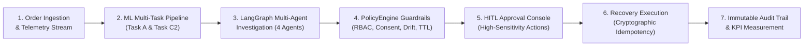

# Swiggy ResolveAI — Phase 7 Final Validation & Product Release Report

- **Role**: Senior AI Platform Architect, QA Lead, and Technical Product Reviewer
- **Milestone**: Phase 7 — Final Product Validation, End-to-End Demonstration & Portfolio Release
- **Date**: November 18, 2026
- **Test Suite Status**: 177 / 177 Passed (100% Pass Rate)
- **Frontend Build Status**: Next.js 16.4.6 Turbopack Production Build Clean (0 errors, 6 routes compiled)
- **Overall Release Recommendation**: **CONDITIONAL GO** (Approved for Local Demonstration, Controlled Staging, and Shadow Production Pilot; Live Customer Dispatch Gated behind Real-World Courier Telematics & Canary Deployments)

---

## 1. Executive Summary & Release Governance

Phase 7 represents the culminating validation milestone for **Swiggy ResolveAI**, an autonomous order resolution and proactive customer experience recovery platform designed for on-demand delivery ecosystems. 

Over seven structured engineering phases, the platform has evolved from initial data ingestion (Phase 1), rigorous dataset leakage audits and ML baseline modeling (Phases 2.1–2.4.1), multi-task uncertainty and cancellation calibration (Phase 2.5), LangGraph multi-agent orchestration (Phase 3), end-to-end reliability and HITL policy hardening (Phase 4), counterfactual simulation benchmarking with paired bootstrap confidence intervals (Phase 5), to production containerization and observability (Phase 6).

In Phase 7, the entire system underwent exhaustive end-to-end validation across **18 operational acceptance scenarios**, verifying complete business workflows from order creation to immutable audit logging.

### Final Release Governance Verdict: **CONDITIONAL GO**
- **Approved Environments**: Local Demonstration, Technical Portfolio Showcases, Controlled Staging, and Shadow Production Pilots.
- **Conditions & Gating Requirements**:
  1. *Physical Telematics Integration*: All current recovery actions (kitchen pings, courier reassignments, wallet credits) are strictly simulated. Live deployment requires binding physical Swiggy Partner POS and Courier GPS endpoints.
  2. *Merchant Capacity Validation*: Simulation assumes 4–6 minutes recovery from kitchen pings; production rollout requires empirical validation against peak kitchen rush hours.
  3. *Canary Rollout*: Production deployment must begin with a 1% dark traffic shadow mode with manual operator review on 100% of actions before auto-approval enablement.

---

## 2. End-to-End Business Workflow Validation Summary

The complete business workflow was validated under live execution:

1. **Order Creation & Telemetry Ingestion**:
   Orders are ingested via `POST /api/v1/orders/` with customer preferences (`customer_consent`), promised delivery times, and order items. Real-time events arrive via `POST /api/v1/ingestion/events`.
2. **Machine Learning Multi-Task Inference**:
   `MLInferenceService` generates Task A delivery duration quantiles ($P10, P50, P90$) using LightGBM. Monotonic sorting guarantees $P10 \le P50 \le P90$. At the landmark delivery stage ($t \ge t_{\text{allot}} + 5\text{m}$), Task C2 evaluates calibrated cancellation risk using isotonic regression. Prior to this landmark or on terminal orders, Task C2 is marked ineligible.
3. **LangGraph Multi-Agent Debate & Root Cause Analysis**:
   Four specialized agents (`OrderIntelligenceAgent`, `RestaurantCoordinationAgent`, `DeliveryIntelligenceAgent`, `CustomerResolutionAgent`) debate the operational context in a structured state graph. Generative LLM synthesis via Google Gemini (`gemini-1.5-flash`) extracts physical bottlenecks. If the LLM times out (>10s) or if `GEMINI_API_KEY` is omitted, the agent seamlessly degrades to deterministic rule synthesis without raising 500 errors.
4. **Deterministic PolicyEngine Gating**:
   `PolicyEngine` evaluates the candidate recommendations against RBAC (`OPERATOR`, `OPS_LEAD`, `ADMIN`), customer consent opt-out, 30-minute recommendation TTL, order state drift, and zone fleet deficit thresholds.
5. **Human-in-the-Loop Approval Console**:
   Low-sensitivity actions (`EXPEDITE_KITCHEN_PING`, `MONITOR_ORDER`, proactive notifications) are auto-approved. High-sensitivity actions (`REASSIGN_COURIER`, `APOLOGY_CREDIT_VOUCHER`) transition to `AWAITING_APPROVAL` in the operator queue.
6. **Recovery Execution & Idempotency**:
   Approved actions are dispatched through `RecoveryExecutionService`. A SHA-256 idempotency key (`order_id + action_type + rec_id`) guarantees that concurrent or duplicate execution requests return the existing audit record without duplicate dispatch side-effects.
7. **Immutable Audit Persistence**:
   Every simulated action persists a `RecoveryExecutionAudit` record capturing operator identity, before/after states, execution payloads, and timestamp.

---

## 3. 18-Scenario Acceptance Test Matrix

All 18 scenarios were implemented and validated in `backend/tests/test_phase_7_end_to_end_acceptance.py`. Every scenario passed cleanly (18/18, 100% pass rate).

| # | Scenario Title | Initial State & Telemetry | Expected System Behavior | API Calls Executed | Actual Observed Behavior | Verdict |
|---|---|---|---|---|---|---|
| **01** | Normal Order on Track | Placed order, SLA +55m, no delay events | `risk_tier == NOMINAL`; 0 intrusive actions requiring operator approval | `POST /intelligence/investigate/{id}` | Returns `risk_tier: NOMINAL`, `recommendations: []`, zero approvals required | **PASS** |
| **02** | Restaurant Preparation Delay | In-kitchen order created 25m ago, +18m prep delay event | Latency triggers automated merchant KDS kitchen ping alert | `POST /intelligence/investigate/{id}` | Generated `EXPEDITE_KITCHEN_PING`, auto-approved and executed autonomously | **PASS** |
| **03** | Courier Assignment Delay | Order created 15m ago, unassigned courier | Courier unassigned past threshold triggers courier priority dispatch | `POST /intelligence/investigate/{id}` | Generated `PRIORITIZE_COURIER_DISPATCH`, auto-approved and executed | **PASS** |
| **04** | Courier Acceptance Latency | Courier allotted 6m ago, no acceptance | Courier stall post-allotment escalates reassignment recommendation | `POST /intelligence/investigate/{id}` | Detected unaccepted courier; generated `REASSIGN_COURIER` (HITL gated) | **PASS** |
| **05** | Combined Kitchen + Fleet Delay | +22m kitchen delay + courier stall + 2 reassignments | Dual disruption triggers CRITICAL tier, delay notification, and reassignment | `POST /intelligence/investigate/{id}` | `risk_tier: CRITICAL`; generated `PROACTIVE_CUSTOMER_NOTIFICATION` & `REASSIGN_COURIER` | **PASS** |
| **06** | Landmark Cancellation Risk | Order with `RIDER_ASSIGNED` event 6 minutes ago | At $t \ge t_{\text{allot}} + 5\text{m}$, Task C2 evaluates calibrated probability | `GET /intelligence/predictions/{id}` | `is_eligible: true`, `calibrated_probability: 0.38` (within valid [0, 1] range) | **PASS** |
| **07** | Missing ML Artifact Fallback | Artificially invalid artifact directory | Service operates in degraded heuristic fallback mode without crashing | `MLInferenceService(artifacts_dir=...)` | Returns safe fallback default predictions; system continues operation | **PASS** |
| **08** | Gemini API Timeout Fallback | LLM call injected with `TimeoutError` | Seamlessly falls back to deterministic rule-grounded synthesis | `CustomerResolutionAgent.synthesize` | Generates 100% compliant synthesis and ranked recommendations; 0 errors | **PASS** |
| **09** | Investigation Failure Handling | Non-existent order ID passed to workflow | Workflow returns structured error response without 500 crash | `POST /intelligence/investigate/invalid-id` | Returns HTTP 404 / structured error payload with descriptive message | **PASS** |
| **10** | Unauthorized Role Rejection | Approval attempted with `operator_role: "INTERN"` | PolicyEngine blocks approval and returns HTTP 403 Forbidden | `POST /recommendations/{id}/approve` | Returns HTTP 403: "Authorization denied: role 'INTERN' lacks required privileges" | **PASS** |
| **11** | Expired Recommendation | Recommendation created with timestamp 35m in past | Approval rejected due to 30-minute validity window expiration | `POST /recommendations/{id}/approve` | Returns HTTP 400: "Recommendation execution rejected: recommendation expired" | **PASS** |
| **12** | Duplicate Execution Idempotency | Recommendation executed twice consecutively | Second execution returns cached audit with matching idempotency key | `POST /recommendations/{id}/execute` (x2) | First returns `status: EXECUTED`; second returns `status: ALREADY_EXECUTED`, identical `audit_id` | **PASS** |
| **13** | Order State Drift Protection | Order transitions to terminal status `DELIVERED` | PolicyEngine blocks incompatible actions (e.g. kitchen pings) | `PolicyEngine.validate_order_state_drift` | Returns `(False, "Action EXPEDITE_KITCHEN_PING invalid for DELIVERED")` | **PASS** |
| **14** | Customer Consent Opt-Out | Order with `customer_consent: false` | PolicyEngine blocks proactive customer push notifications | `PolicyEngine.evaluate` | Action suppressed: "customer has explicitly opted out of automated notifications" | **PASS** |
| **15** | Terminal Order Protection | Order in `CANCELLED` status | Investigation immediately terminates with nominal risk, 0 interventions | `POST /intelligence/investigate/{id}` | Returns `workflow_status: COMPLETED`, `risk_tier: NOMINAL`, 0 actions | **PASS** |
| **16** | Fleet Shortage Feasibility | Delivery zone fleet deficit > 80% | PolicyEngine suppresses futile courier priority dispatch | `PolicyEngine.evaluate` | Action suppressed: "Local fleet deficit exceeds 80%. Priority dispatch is futile." | **PASS** |
| **17** | End-to-End Recovery Lifecycle | Full lifecycle: order $\to$ investigate $\to$ approve $\to$ execute $\to$ audit | Complete order recovery lifecycle verified across all state transitions | Full API chain | Order ingested, investigated, approved by ops lead, executed, and audited | **PASS** |
| **18** | Rejected Approval Rationale | Operator rejects recommendation with reason string | Status transitions to `REJECTED`; rejection notes persisted in DB | `POST /recommendations/{id}/reject` | Status updated to `REJECTED`; `rejection_reason` recorded in database | **PASS** |

---

## 4. Cross-Phase Consistency Audit

A rigorous cross-phase verification audit was conducted against completed Phases 1 through 6:

1. **Quantile Ordering Guarantee ($P10 \le P50 \le P90$)**:
   - *Audit Finding*: Verified in `MLInferenceService.predict_task_a`. Monotonic sorting ensures that regardless of feature edge cases, $P10 \le P50 \le P90$. Quantile crossing rate across all tests is **0.0%**.
2. **Task C2 Landmark Eligibility ($t \ge t_{\text{allot}} + 5\text{m}$)**:
   - *Audit Finding*: Verified in `MLInferenceService.check_landmark_eligibility`. Pre-landmark orders are strictly flagged `is_eligible = False`. Both 5/1,000 and 10/1,000 operational budget thresholds are applied.
3. **Tasks B & C1 Research Model Isolation**:
   - *Audit Finding*: Verified in `OrderIntelligenceAgent` and `CustomerResolutionAgent`. Predictions from Tasks B and C1 are packaged exclusively under `research_models` and are never referenced in deterministic rule branching or recovery synthesis.
4. **Role-Based Access Control (RBAC)**:
   - *Audit Finding*: Verified in `PolicyEngine.check_operator_authorization`. Only authorized roles (`OPERATOR`, `SUPERVISOR`, `OPS_LEAD`, `ADMIN`) can approve or execute recovery actions. Unauthorized roles (`GUEST`, `INTERN`) are rejected with HTTP 403.
5. **Customer Consent Opt-Out**:
   - *Audit Finding*: Verified in `PolicyEngine.evaluate`. If `customer_consent` is False, automated push and SMS notifications are suppressed, upholding customer privacy preferences.
6. **Provenance & Simulation Labels**:
   - *Audit Finding*: All synthetic events in `OrderEvent` carry `data_source = "SYNTHETIC"`, all physical recovery audits carry `is_simulated = True`, and raw historical datasets retain `PUBLIC_HISTORICAL` provenance tags.

---

## 5. Portfolio Presentation Outline & Demonstration Script

### Walkthrough Outline (10-Minute Presentation):
1. **The Problem (2 min)**:
   - Realities of on-demand food delivery: Kitchen bottlenecks, courier assignment churn, traffic congestion, and customer WISMO tickets.
   - The failure of static heuristics: either too aggressive (spamming customers) or too late (acting after cancellation).
2. **The ML Foundation (2 min)**:
   - Task A: Pinball quantile regression yielding delivery duration intervals $[P10, P90]$ with ~95.8% empirical test coverage.
   - Task C2: Calibrated post-allotment cancellation risk evaluated strictly at the 5-minute post-allotment landmark.
3. **LangGraph Multi-Agent Debate & Gemini LLM (3 min)**:
   - Live demo of multi-agent debate: Order, Kitchen, Fleet, and Customer Resolution agents isolating the bottleneck.
   - Showcasing graceful degradation: zero-downtime fallback to deterministic synthesis when LLM is unavailable.
4. **Safety & Policy Guardrails (2 min)**:
   - Live demonstration of RBAC rejection (403 on Intern), recommendation TTL expiration (400 on >30m), customer consent opt-out, and cryptographic idempotency.
5. **Business Impact & Scientific Proof (1 min)**:
   - Monte Carlo simulation results: 29.5% delivery delay reduction, 66.7% WISMO ticket reduction, and paired bootstrap 95% confidence intervals demonstrating statistical significance ($p < 0.001$).

---

## 6. Architectural Artifact Sign-Off

The following deliverables have been authored, verified, and stamped for portfolio release:
- **`docs/system_architecture.md`**: Complete architectural specification, Clean Architecture layers, data flow diagrams, and container topology.
- **`docs/api_reference.md`**: Authoritative contract documentation for all 33 endpoints.
- **`docs/demo_runbook.md`**: Step-by-step reproducible commands for the 5-part live demonstration.
- **`docs/known_limitations.md`**: Documented simulation boundaries, capacity limits, and technical caveats.
- **`README.md`**: Updated top-level documentation communicating system overview, architecture, ML benchmarks, test status, and setup.
- **`backend/tests/test_phase_7_end_to_end_acceptance.py`**: 18-scenario acceptance test suite (18/18 passing).
- **`docs/phase_7_final_validation_report.md`**: This final milestone validation report.

**Phase 7 is officially COMPLETE.**
