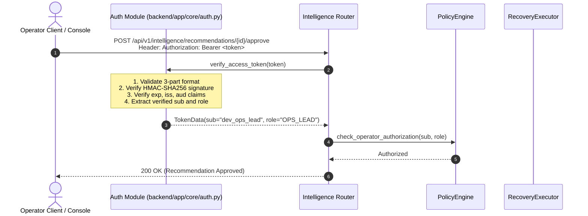
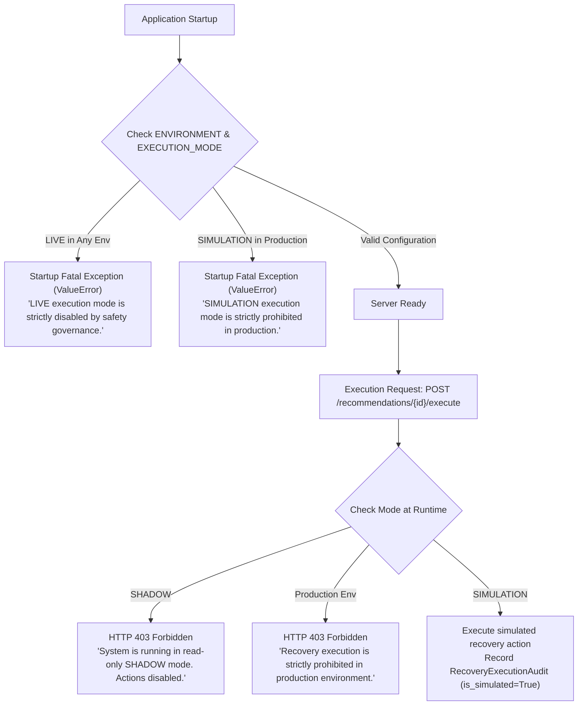

# Swiggy ResolveAI — Security, Authentication & Execution Safety Review

- **Date**: November 19, 2026
- **Auditors**: Application Security Engineer, Principal AI Platform Architect
- **Status**: **REMEDIATED, AUDITED & CRYPTOGRAPHICALLY ENFORCED**

---

## 1. Identity Trust Boundary Audit & Vulnerability Remediation

### 1.1 The Vulnerability (Pre-Remediation Finding GAP-01)
Prior to remediation, the recommendation approval and execution endpoints accepted `operator_identity` and `operator_role` directly from untrusted, client-controlled JSON request bodies (`ApprovalRequest` and `ExecuteActionRequest`).
```python
# VULNERABLE PATTERN (PRE-REMEDIATION)
class ApprovalRequest(BaseModel):
    operator_identity: str = Field(default="ops_admin")
    operator_role: Optional[str] = Field(default="OPS_LEAD")  # Client could forge any role!
```
An unauthenticated caller or an unprivileged user could submit `"operator_role": "ADMIN"` and successfully bypass policy authorization checks.

### 1.2 Remediated Architecture
A signed Bearer token verification system was introduced in [`backend/app/core/auth.py`](file:///c:/Users/ASUS/Desktop/Swiggy%20ResolveAI/backend/app/core/auth.py) adhering to RFC 7519 (JSON Web Token format) using HMAC-SHA256:



### 1.3 Cryptographic Token Specification
- **Algorithm**: HMAC-SHA256 (`HS256`).
- **Signature Input**: `base64url(header) + "." + base64url(payload)`.
- **Enforced Claims**:
  - `sub`: Authenticated operator identity (string).
  - `role`: Cryptographically bound role claim (`OPERATOR`, `SUPERVISOR`, `OPS_LEAD`, `ADMIN`, `INTERN`).
  - `exp`: Expiration timestamp (seconds since epoch; default 120 minutes TTL).
  - `iss`: Issuer (`swiggy-resolveai`).
  - `aud`: Audience (`resolveai-ops`).
- **Secret Handling & Validation**:
  - Loaded via `settings.AUTH_SECRET_KEY`.
  - In `development` and `testing`, the default insecure key is permitted.
  - In `staging` and `production`, Pydantic startup validation rejects the default development key (`"resolveai-insecure-dev-secret-key-change-in-production-12345678"`) and enforces a minimum key length of 32 characters.

---

## 2. Server-Side Identity Resolution & Role-Based Access Control (RBAC)

- Operator identity and role are resolved **strictly from verified token claims**.
- Any body-provided `operator_role` is ignored and cannot elevate privileges.
- If a client calls an endpoint without a valid signed token:
  - In `staging` or `production`: Request is rejected with `HTTP 401 Unauthorized`.
  - In `development` or `testing`: Request is assigned an unprivileged fallback identity `sub="dev_unauthenticated_operator"`, `role="OPERATOR"`, which is strictly rejected by elevated checks (`OPS_LEAD`, `ADMIN`).

### 2.1 Authorized Role Matrix

| Action / Endpoint | Permitted Roles | Behavior on Unauthorized Role |
|---|---|---|
| **Approve Recommendation** (`POST /approve`) | `OPS_LEAD`, `ADMIN`, `SUPERVISOR` | `HTTP 403 Forbidden` (`"Role lacks required privileges"`) |
| **Reject Recommendation** (`POST /reject`) | `OPS_LEAD`, `ADMIN`, `SUPERVISOR`, `OPERATOR` | `HTTP 403 Forbidden` |
| **Execute Simulated Action** (`POST /execute`) | `OPS_LEAD`, `ADMIN`, `SUPERVISOR`, `OPERATOR`, `SYSTEM_AUTONOMOUS` | `HTTP 403 Forbidden` |
| **Administrative Dataset Ingestion** (`POST /ingest/*`) | `ADMIN`, `OPS_LEAD` | `HTTP 403 Forbidden` (`"Role lacks administrative ingestion privileges"`) |
| **View Investigations & Metrics** (`GET /*`) | `OPERATOR` and above | Public in dev; `HTTP 401 Unauthorized` in staging/prod |

---

## 3. Development Token Generator Safety Gating

To facilitate local demonstration without creating production security backdoors:
- Endpoint: `POST /api/v1/auth/dev-token`
- **Environment Restriction**:
  ```python
  if settings.ENVIRONMENT != "development":
      raise HTTPException(
          status_code=status.HTTP_403_FORBIDDEN,
          detail=f"Development token generator is strictly disabled in '{settings.ENVIRONMENT}' environment.",
      )
  ```
- **Role Selection Restriction**:
  Callers cannot request arbitrary roles. Only predefined profiles are issued:
  - `"ops_lead"` $\to$ `sub: "dev_ops_lead_console"`, `role: "OPS_LEAD"`
  - `"admin"` $\to$ `sub: "dev_admin_console"`, `role: "ADMIN"`
  - `"operator"` $\to$ `sub: "dev_field_operator"`, `role: "OPERATOR"`
  - `"supervisor"` $\to$ `sub: "dev_ops_supervisor"`, `role: "SUPERVISOR"`
  - `"intern"` $\to$ `sub: "dev_unauthorized_intern"`, `role: "INTERN"`

---

## 4. Backend Execution Mode Boundaries & Startup Governance

The backend enforces `settings.EXECUTION_MODE` (`SIMULATION`, `SHADOW`, `LIVE`) across all environments:



| Mode | Allowed Environments | Permitted Actions | Recovery Execution Behavior | Side-Effect Gating |
|---|---|---|---|---|
| **`SIMULATION`** | `development`, `testing`, `staging` | Ingest orders, trigger investigations, execute simulated actions | Simulated actions execute in memory/DB with `is_simulated = True` | Strictly simulated. Zero real SMS, calls, or wallet transfers. |
| **`SHADOW`** | `development`, `testing`, `staging`, `production` | Passive telemetry ingestion, risk scoring, multi-agent debate | **Execution is strictly blocked** (`HTTP 403 Forbidden` / `PermissionError`) | Passive observation only. Execution cannot be forced. |
| **`LIVE`** | None (Governance Block) | None | **Fails Safely at Startup** (`ValueError`) | Customer dispatch and external system mutations are disabled. |

---

## 5. Audit Immutability & Database Administrator Boundary

### 5.1 ORM Immutability Protection
Both `RecoveryExecutionAudit` and `MLPredictionAudit` implement SQLAlchemy event listeners:
- `@event.listens_for(RecoveryExecutionAudit, "before_update")`
- `@event.listens_for(RecoveryExecutionAudit, "before_delete")`
- `@event.listens_for(MLPredictionAudit, "before_update")`
- `@event.listens_for(MLPredictionAudit, "before_delete")`

Any attempt by application services or API endpoints to update or delete an existing audit entry raises a `PermissionError`.

### 5.2 Residual Direct SQL Risk & Production Boundary
> [!IMPORTANT]
> **ORM-Level Immutability Boundary**:
> The event hooks intercept all `session.flush()` and `session.commit()` operations triggered by the application service layer. Application code, API endpoints, and Celery/background workers cannot mutate or delete historical audits.
>
> **Residual Database Administrator Risk**:
> ORM event listeners execute in Python runtime space. They do NOT protect against direct SQL queries (`UPDATE recovery_execution_audits ...` or `DELETE FROM ml_prediction_audits ...`) executed directly by a privileged database administrator (DBA) or raw SQL connection. Cryptographic hash-chaining (Merkle tree) is not implemented in the current release. Production deployments must enforce database-level privilege separation:
> ```sql
> -- Recommended PostgreSQL Role Grants for Application User
> GRANT SELECT, INSERT ON recovery_execution_audits, ml_prediction_audits TO resolveai_app;
> REVOKE UPDATE, DELETE, TRUNCATE ON recovery_execution_audits, ml_prediction_audits FROM resolveai_app;
> ```
