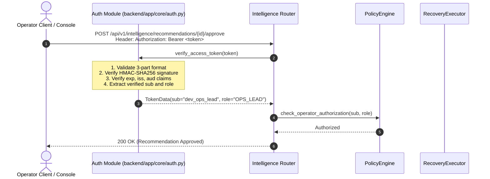
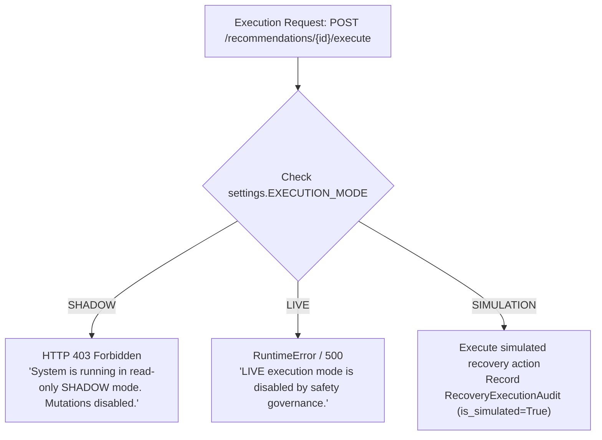

# Swiggy ResolveAI — Security, Authentication & Execution Safety Review

- **Date**: November 18, 2026
- **Auditors**: Application Security Engineer, Principal AI Platform Architect
- **Status**: **REMEDIATED & CRYPTOGRAPHICALLY ENFORCED**

---

## 1. Identity Trust Boundary Audit & Vulnerability Remediation

### 1.1 The Vulnerability (Pre-Remediation Finding GAP-01)
Prior to remediation, the recommendation approval and execution endpoints accepted `operator_identity` and `operator_role` directly from untrusted, client-controlled JSON request bodies (`ApprovalRequest` and `ExecuteActionRequest`).
```python
# VULNERABLE PATTERN (PRE-REMEDIATION)
class ApprovalRequest(BaseModel):
    operator_identity: str = Field(default="ops_admin")
    operator_role: Optional[str] = Field(default="OPS_LEAD")  # Client could forge any role!
```
An unauthenticated caller or an unprivileged user could submit `"operator_role": "ADMIN"` and successfully bypass policy authorization checks.

### 1.2 Remediated Architecture
A signed Bearer token verification system was introduced in [`backend/app/core/auth.py`](file:///c:/Users/ASUS/Desktop/Swiggy%20ResolveAI/backend/app/core/auth.py) adhering to RFC 7519 (JSON Web Token format) using HMAC-SHA256:



### 1.3 Cryptographic Token Specification
- **Algorithm**: HMAC-SHA256 (`HS256`).
- **Signature Input**: `base64url(header) + "." + base64url(payload)`.
- **Enforced Claims**:
  - `sub`: Authenticated operator identity (string).
  - `role`: Cryptographically bound role claim (`OPERATOR`, `SUPERVISOR`, `OPS_LEAD`, `ADMIN`, `INTERN`).
  - `exp`: Expiration timestamp (seconds since epoch; default 120 minutes TTL).
  - `iss`: Issuer (`swiggy-resolveai`).
  - `aud`: Audience (`resolveai-ops`).
- **Secret Handling**: Loaded via `settings.AUTH_SECRET_KEY` from environment. In `production`, startup validation enforces secret key rotation.

---

## 2. Server-Side Identity Resolution & Gating

- Operator identity and role are resolved **strictly from verified token claims**.
- Any body-provided `operator_role` is ignored and cannot elevate privileges.
- If a client passes an untrusted role string without a signed token:
  - In `staging` or `production`: Request is rejected with `HTTP 401 Unauthorized`.
  - In `development`: Request is assigned unprivileged fallback `role="OPERATOR"`, which is strictly rejected by `require_roles(["OPS_LEAD", "ADMIN"])` with `HTTP 403 Forbidden`.
  - Impersonating `OPS_LEAD` or `ADMIN` without a valid signed token is impossible.

---

## 3. Development Token Generator Safety Gating

To facilitate local development without creating security backdoors:
- Endpoint: `POST /api/v1/auth/dev-token`
- **Environment Restriction**:
  ```python
  if settings.ENVIRONMENT != "development":
      raise HTTPException(
          status_code=status.HTTP_403_FORBIDDEN,
          detail=f"Development token generator is strictly disabled in '{settings.ENVIRONMENT}' environment.",
      )
  ```
- **Role Selection Restriction**:
  Callers cannot request arbitrary roles. Only predefined profiles are issued:
  - `"ops_lead"` $\to$ `sub: "dev_ops_lead_console"`, `role: "OPS_LEAD"`
  - `"admin"` $\to$ `sub: "dev_admin_console"`, `role: "ADMIN"`
  - `"operator"` $\to$ `sub: "dev_field_operator"`, `role: "OPERATOR"`
  - `"intern"` $\to$ `sub: "dev_unauthorized_intern"`, `role: "INTERN"`

---

## 4. Backend Execution Mode Boundaries

Configured via `settings.EXECUTION_MODE` (`SIMULATION`, `SHADOW`, `LIVE`):



| Mode | Allowed Actions | Side-Effect Gating |
|---|---|---|
| **`SIMULATION`** | Ingest orders, trigger investigations, execute simulated actions | Actions executed in memory/DB with `is_simulated = True`. Zero real SMS/calls/funds. |
| **`SHADOW`** | Passive ingestion, telemetry monitoring, multi-agent debate, risk scoring | **Execution is strictly blocked** (`HTTP 403`). Audit logs capture counterfactual decisions only. |
| **`LIVE`** | Customer dispatch, partner POS calls, wallet credits | **Permanently disabled** by governance policy. Attempted execution raises a runtime safety error. |
