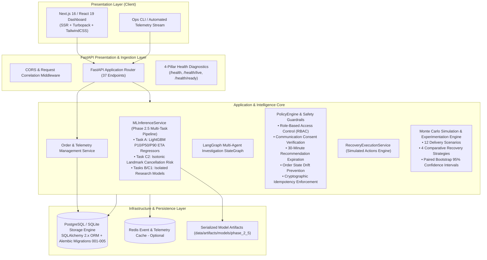
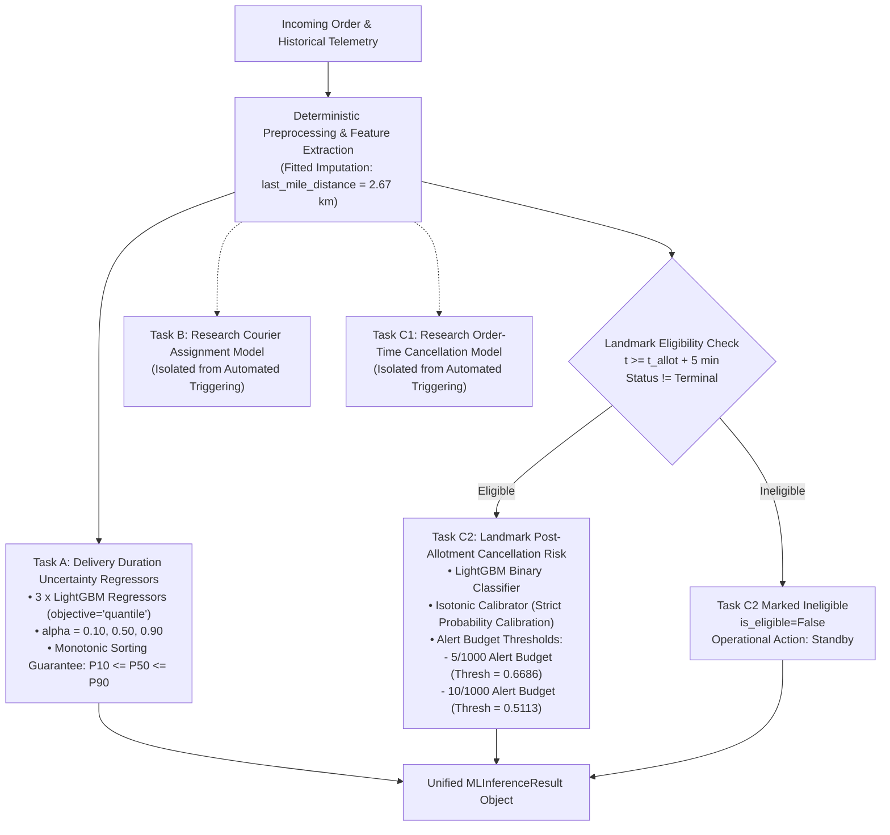
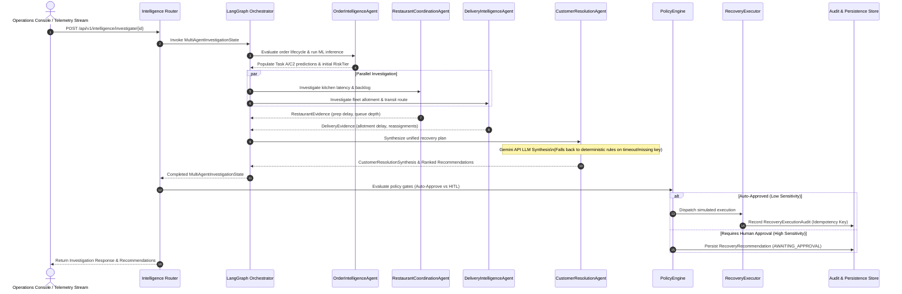
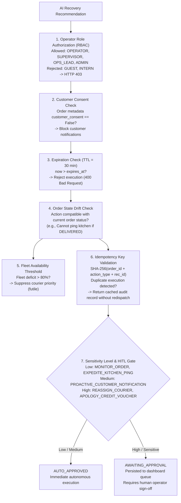
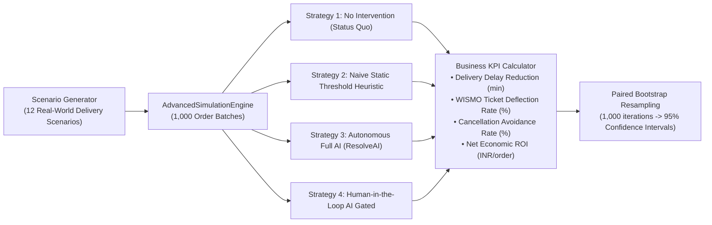
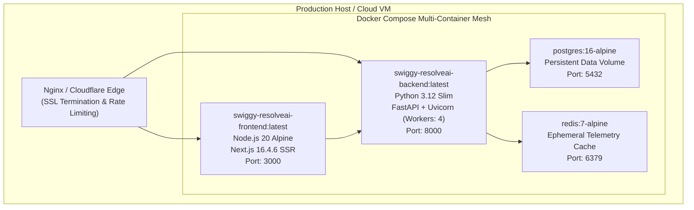

# Swiggy ResolveAI — System Architecture Blueprint

## 1. Executive Architecture Overview

**Swiggy ResolveAI** is an autonomous, AI-driven order resolution and proactive customer experience recovery platform designed for high-throughput food delivery ecosystems. The system detects operational disruptions in real time (merchant kitchen bottlenecks, delivery courier assignment delays, transit corridor congestion, and post-allotment order cancellation risks), conducts structured multi-agent investigations, and executes calibrated recovery workflows under strict human-in-the-loop and policy guardrails.

The platform follows a **Modular Monolith** pattern adhering strictly to **Clean Architecture** and **SOLID** principles, ensuring clear separation of concerns, high testability, low operational complexity, and seamless local or containerized deployment without distributed microservices overhead.

---

## 2. Clean Architecture Layering

The codebase is organized into four concentric layers to decouple business domain entities from external libraries, database drivers, and UI frameworks:

```mermaid
flowchart LR
    subgraph Layer4["Presentation Layer"]
        API["FastAPI Endpoints\n(backend/app/api)"]
        WebUI["Next.js Pages & Components\n(frontend/src)"]
    end

    subgraph Layer3["Application Services Layer"]
        IntellSvc["IntelligenceService"]
        OrderSvc2["OrderService"]
        SimSvc["SimulationService"]
        Policy["PolicyEngine"]
        RecExec["RecoveryExecutionService"]
    end

    subgraph Layer2["Domain Intelligence Layer"]
        MultiAgent["LangGraph Multi-Agent Core\n(Order, Restaurant, Delivery, Resolution)"]
        MLPlatform["MLInferenceService & Preprocessing Pipeline"]
    end

    subgraph Layer1["Core Domain & Data Layer"]
        Models["SQLAlchemy Declarative Models\n(Order, Event, Customer, Restaurant, Audit)"]
        Schemas["Pydantic Domain Schemas"]
        DBBase["Database Session & Base Engine"]
    end

    Layer4 --> Layer3
    Layer3 --> Layer2
    Layer2 --> Layer1
```

### 2.1 Core Domain Layer (`backend/app/models/`)
Contains declarative SQLAlchemy entities with zero business logic dependencies:
- **`Order`**: Tracks lifecycle state (`PLACED`, `IN_KITCHEN`, `ALLOTTED`, `PICKED_UP`, `DELIVERED`, `CANCELLED`), order values, timestamps, and customer/restaurant references.
- **`OrderEvent`**: Append-only telemetry log capturing milestones and synthetic operational anomalies.
- **`Customer` & `Restaurant` & `DeliveryPartner`**: Core physical entities.
- **`OrderInvestigation` & `RecoveryRecommendation`**: AI investigation records and prioritized recovery candidate actions.
- **`RecoveryExecutionAudit`**: Cryptographically verifiable audit log with unique idempotency keys, operator identities, before/after states, and simulated execution payloads.

### 2.2 Application Services Layer (`backend/app/services/`)
Coordinates use cases, orchestrates transactions, and enforces operational policies:
- **`OrderService`**: Lifecycle mutations, validation, and historical order querying.
- **`IntelligenceService`**: Facade exposing investigation invocation, recommendation retrieval, operator approval gating, and execution triggering.
- **`PolicyEngine`**: Pure deterministic rule validator evaluating RBAC, customer consent, cooldown periods, time-to-live expiration, and state drift.
- **`RecoveryExecutionService`**: Executes approved recovery actions atomically with audit persistence.
- **`SimulationService` / `AdvancedSimulationEngine`**: Scientific evaluation framework running counterfactual policy comparisons.

### 2.3 Presentation Layer (`backend/app/api/` & `frontend/src/`)
- **FastAPI**: 37 type-safe REST endpoints with automated OpenAPI documentation and correlation ID tracking across authentication, orders, investigations, simulations, and system health.
- **Next.js 16**: Server-side and client-side React 19 dashboard featuring real-time telemetry tables, investigation debug drawers, interactive HITL approval consoles, and Monte Carlo simulation visualizers.

---

## 3. Machine Learning Intelligence Pipeline

ResolveAI integrates two distinct operational ML models persisted in Phase 2.5 (`data/artifacts/models/phase_2_5/`), alongside two isolated research models:

### 3.1 Task A — Delivery Duration Uncertainty Regressors
- **Architecture**: 3 LightGBM regressors trained with pinball quantile loss at $\alpha \in \{0.10, 0.50, 0.90\}$.
- **Guarantee**: Monotonicity post-processing ensures $P10 \le P50 \le P90$ for every prediction without quantile crossing.
- **Interval Coverage**: 80% central prediction interval $[P10, P90]$ achieves ~95.8% empirical coverage across core delivery regimes (20–35 min).
- **Long-Tail Diagnostics**: Flags orders where $P90 - P50 > 15\text{ min}$ as extreme delivery uncertainty.

### 3.2 Task C2 — Calibrated Post-Allotment Cancellation Risk
- **Landmark Eligibility Gate**: Evaluated exclusively at $t \ge t_{\text{allot}} + 5\text{ minutes}$. Earlier orders or terminal orders are marked ineligible.
- **Model Architecture**: LightGBM binary classifier paired with scikit-learn `IsotonicRegression` probability calibrator.
- **Dual Budget Thresholds**:
  - `alert_budget_5_per_1000` (threshold = 0.6686): High-precision tier for severe risk.
  - `alert_budget_10_per_1000` (threshold = 0.5113): Medium-precision tier for active monitoring.
- **Safety Policy**: Does not trigger disruptive interventions; restricted to non-intrusive operational monitoring and proactive communication.

---

## 4. LangGraph Multi-Agent Architecture

When an order disruption or manual operator trigger occurs, the platform initiates a multi-agent debate and synthesis workflow orchestrated via **LangGraph**:

### Specialized Agents:
1. **`OrderIntelligenceAgent`**:
   - Assesses lifecycle eligibility (rejects terminal orders).
   - Ingests Task A quantiles and Task C2 calibrated cancellation probabilities.
   - Computes projected delay against customer promised delivery time.
   - Assigns operational risk tier: `NOMINAL`, `MONITORED`, `HIGH_RISK`, or `CRITICAL`.
2. **`RestaurantCoordinationAgent`**:
   - Evaluates merchant acceptance latency and kitchen preparation timeline.
   - Distinguishes physical KDS telemetry from simulated peak backlogs.
   - Formulates kitchen bottleneck diagnoses.
3. **`DeliveryIntelligenceAgent`**:
   - Analyzes courier allotment latency, acceptance delays, and reassignment churn.
   - Detects extreme first-mile transit distances (>3.0 km) and corridor traffic congestion.
4. **`CustomerResolutionAgent`**:
   - Synthesizes findings from Order, Kitchen, and Fleet agents into a root cause explanation.
   - Invokes Google Gemini (`gemini-3.5-flash`) via structured JSON schema prompts.
   - Graceful Degradation: If `GEMINI_API_KEY` is absent, invalid, or times out (>10s), automatically falls back to deterministic rule-grounded synthesis without raising errors.

---

## 5. Governance, PolicyEngine & HITL Gating

To prevent reckless automated actions, financial waste, or operational panic, every AI recommendation is evaluated against the deterministic **PolicyEngine**:

---

## 6. Simulation & Evaluation Framework (Phase 5)

The platform includes a high-fidelity Monte Carlo simulation engine (`backend/app/simulation/`) designed to evaluate autonomous recovery against baseline operational policies:

---

## 7. Container Topology & Deployment Architecture

### Health Diagnostics:
- **`GET /health`**: Unified status across Database, Redis, Model Registry, and Application uptime.
- **`GET /health/live`**: Kubernetes/Docker liveness probe verifying process responsiveness.
- **`GET /health/ready`**: Kubernetes/Docker readiness probe verifying database connectivity and ML artifact availability.

---

## 8. Security Architecture, Authentication & Execution Safeguards

### 8.1 Cryptographic Authentication & RBAC Boundary
- **RFC 7519 HMAC-SHA256 Bearer Tokens**: All sensitive administrative and operational actions (`approve_recommendation`, `reject_recommendation`, `execute_recommendation`) require verified bearer tokens signed with `AUTH_SECRET_KEY`.
- **Identity Trust Boundary Elimination**: Client requests cannot forge operator identities or roles via request body parameters (`operator_id`, `operator_role`). Identity and role claims (`sub`, `role`, `name`) are resolved exclusively on the server from validated cryptographic tokens.
- **Gated Development Endpoint**: In local environments (`ENVIRONMENT=development`), `POST /api/v1/auth/dev-token` issues test tokens for certified personas (`ops_lead`, `admin`, `operator`, `intern`). In staging and production environments, this endpoint is strictly disabled (HTTP 403 Forbidden).

### 8.2 Execution Safety Modes
The backend enforces three runtime execution modes configured via `EXECUTION_MODE`:
1. **`SIMULATION`** (Default): Recovery actions execute against local database state; synthetic side-effects (e.g. merchant push, courier re-dispatch) are simulated and logged.
2. **`SHADOW`**: Complete pipeline executes (order ingestion, ML inference, multi-agent debate, recommendation ranking); physical execution of recovery actions is blocked at the execution boundary and rejected with HTTP 403 Forbidden.
3. **`LIVE`**: Protected production mode. The system raises a fatal initialization error if configured for live recovery, guaranteeing safety until external Swiggy production APIs and telematics systems are formally certified.

### 8.3 Append-Only Audit Immutability
- **ORM Event Listeners**: SQLAlchemy event listeners (`before_update` and `before_delete`) are attached to the `RecoveryExecutionAudit` model.
- **Tamper Prevention**: Any programmatic attempt within the ORM to modify or delete historical audit records raises a fatal `PermissionError`, ensuring an unalterable compliance ledger for all automated and HITL recovery actions.
